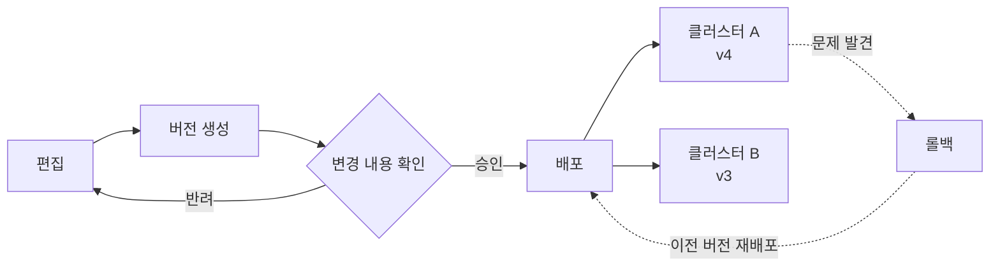
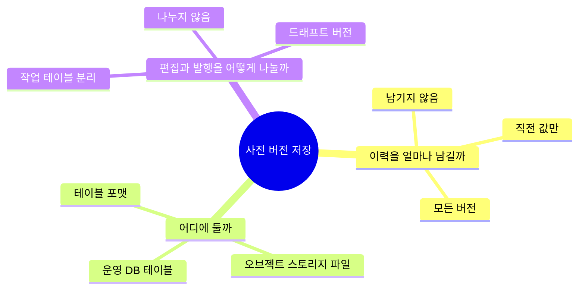

# 사전 저장 개요

검색 사전(동의어 사전, 사용자 사전)은 운영자가 편집하고, 버전으로 묶어 검색 클러스터에 배포하는 데이터다. 이 묶음은 사전의 버전을 어디에, 어떤 모양으로 저장할지에 대한 대안을 데이터 엔지니어링 패턴 이름과 연결해 정리한다.

## 풀어야 할 문제

사전은 한 번 배포하면 검색 결과 전체에 영향을 주기 때문에, 저장 방식은 편집의 편의보다 배포의 안전을 기준으로 고르게 된다.

저장 방식이 만족해야 하는 요구사항은 다음과 같다.

- 변경 확인: 배포 전에 직전 버전과 무엇이 달라졌는지 행 단위로 볼 수 있어야 함
- 롤백: 과거 버전의 사전을 그대로 다시 배포할 수 있어야 함
- 클러스터별 버전: 클러스터마다 서로 다른 버전을 쓰는 상태를 표현할 수 있어야 함
- 이어서 편집: 과거 버전을 불러와 수정한 뒤 새 버전으로 낼 수 있어야 함
- 저장량 통제: 버전이 쌓여도 조회 성능과 비용이 무너지지 않아야 함

## 세 가지 설계 축

대안이 많아 보이지만 실제로는 세 가지 질문에 각각 답을 고르는 문제다. 한 축에서 고른 답이 다른 축의 선택지를 좁히기 때문에, 축을 나눠 놓고 보면 조합이 눈에 들어온다.

- 이력의 깊이: 과거 값을 버릴지, 직전 값만 둘지, 모든 버전을 재구성할 수 있게 둘지의 선택
- 저장 위치: 조회와 비교가 쉬운 운영 DB와, 싸고 큰 오브젝트 스토리지 사이의 선택
- 편집과 발행의 분리: 작업 중인 내용이 실수로 배포되지 않게 막는 경계를 어디에 둘지의 선택

## 대안과 패턴 지도

회의나 설계 리뷰에서 나오는 표현은 대부분 이미 이름이 붙은 패턴의 한 형태다. 표의 문서 이름을 누르면 해당 패턴의 설명으로 이동한다.

| 흔히 나오는 대안 | 패턴 이름 | 문서 |
|---|---|---|
| TRUNCATE 후 재적재 | SCD Type 1, 전체 갱신 | [SCD](dictionary-storage/scd.md) |
| 이전 값(before) 컬럼 | SCD Type 3 | [SCD](dictionary-storage/scd.md) |
| 유효 구간 컬럼 | SCD Type 2, 시스템 버전 테이블 | [SCD](dictionary-storage/scd.md) |
| 버전 컬럼 + 파티셔닝 | 전체 스냅샷, 파티션 리텐션 | [스냅샷 테이블과 파티셔닝](dictionary-storage/snapshot-partitioning.md) |
| 버전마다 테이블 | 샤딩 테이블 | [스냅샷 테이블과 파티셔닝](dictionary-storage/snapshot-partitioning.md) |
| 라이브 테이블 + 작업 테이블 | 스테이징 테이블, 테이블 스왑 | [드래프트와 발행 분리](dictionary-storage/draft-publish.md) |
| 드래프트 버전 | 드래프트/발행 워크플로, Copy-on-Write | [드래프트와 발행 분리](dictionary-storage/draft-publish.md) |
| 변경 확인 후 승인 | Write-Audit-Publish | [드래프트와 발행 분리](dictionary-storage/draft-publish.md) |
| S3에 CSV 저장 | 아카이브 계층 | [오브젝트 스토리지 스냅샷](dictionary-storage/object-storage-snapshot.md) |
| S3에 SQLite 파일 저장 | 휴대용 스냅샷 | [오브젝트 스토리지 스냅샷](dictionary-storage/object-storage-snapshot.md) |
| S3 파일에 직접 쿼리 | 쿼리 인 플레이스, 타임 트래블 | [오픈 테이블 포맷과 타임 트래블](dictionary-storage/table-format-time-travel.md) |
| 적재 로그로 비교 | 변경 데이터 캡처, 이벤트 소싱 | [변경 로그 기반 이력](dictionary-storage/change-log.md) |
| 청크 단위 파일 비교 | 정렬-병합 diff | [diff 기법](dictionary-storage/diff.md) |
| 해시 이름으로 저장 | 내용 주소 저장, 불변 아티팩트 | [불변 아티팩트와 내용 주소 저장](dictionary-storage/immutable-artifact.md) |
| 버전 생성과 배포 분리 | 아티팩트 승격 | [불변 아티팩트와 내용 주소 저장](dictionary-storage/immutable-artifact.md) |
| 크론 주기 발행 | 조정 루프 | [원하는 상태와 조정 루프](dictionary-storage/desired-state.md) |
| 클러스터별 버전 테이블 | 원하는 상태 포인터 | [원하는 상태와 조정 루프](dictionary-storage/desired-state.md) |
| 복사만 하는 워커 | 컨트롤 플레인과 데이터 플레인 | [원하는 상태와 조정 루프](dictionary-storage/desired-state.md) |
| 동시 실행 1개 제한 | 직렬 큐, 멱등성 | [멱등성과 직렬 실행](dictionary-storage/idempotency-concurrency.md) |
| 되돌린 뒤 새 버전으로 발행 | 롤포워드 | [롤백과 롤포워드](dictionary-storage/rollback.md) |
