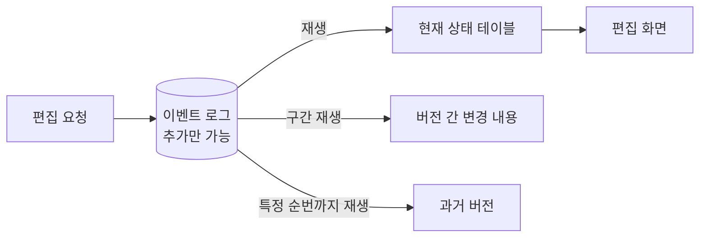
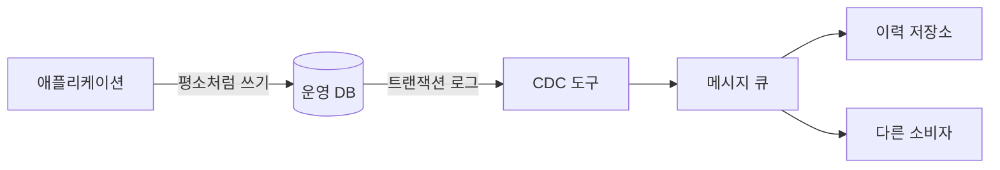

# 변경 로그 기반 이력

상태를 저장하는 대신 "무슨 일이 있었는지"를 순서대로 기록하고, 필요할 때 그 기록에서 상태와 변경 내용을 만들어 내는 방식이다. 강력하지만 로그가 갖춰야 할 조건이 엄격해서, 조건을 채우지 못한 로그에 기대면 이력 전체를 신뢰할 수 없게 된다.

## 상태와 로그

같은 정보를 두 가지 모양으로 저장할 수 있다. 상태(State)는 지금의 결과이고, 로그(Log)는 그 결과에 이르기까지의 사건 목록이다.

로그

| 순번 | 사건 | term | 값 |
|---|---|---|---|
| 1 | 추가 | 후드티 | 후디 |
| 2 | 추가 | 맨투맨 | 스웨트셔츠 |
| 3 | 수정 | 맨투맨 | 스웨트셔츠, 크루넥 |
| 4 | 추가 | 운동화 | 스니커즈 |
| 5 | 삭제 | 운동화 | |

로그를 처음부터 순서대로 적용한 상태

| term | synonyms |
|---|---|
| 후드티 | 후디 |
| 맨투맨 | 스웨트셔츠, 크루넥 |

- 로그 → 상태: 처음부터 순서대로 적용하면 항상 같은 상태가 나옴. 이 과정을 재생(Replay)이라 부름
- 상태 → 로그: 불가능. 상태만 봐서는 `운동화`가 있었다가 지워졌다는 사실을 알 수 없음
- 임의 시점 복원: 원하는 순번까지만 재생하면 그 시점의 상태가 됨

## 이벤트 소싱

이벤트 소싱(Event sourcing)은 로그를 유일한 원본으로 삼는 설계다. 테이블에 보이는 현재 상태는 로그에서 계산해 낸 파생물이고, 언제든 버리고 다시 만들 수 있다.

- 원칙
  - 이벤트는 추가만 하고 수정하거나 지우지 않음
  - 잘못된 이벤트는 고치지 않고 그것을 상쇄하는 새 이벤트를 추가
  - 상태 테이블에 직접 쓰는 경로를 두지 않음
- 장점
  - 모든 변경의 주체, 시각, 내용이 자동으로 남음
  - 어느 시점의 상태든 재구성 가능
  - 변경 내용이 저장 단위 그 자체라 비교를 따로 계산할 필요가 없음
- 단점
  - 로그가 길어지면 재생 시간이 길어져 중간 스냅샷을 주기적으로 만들어야 함
  - 이벤트 형식이 바뀌면 과거 이벤트의 해석 규칙을 계속 유지해야 함
  - 일괄 업로드처럼 한 번에 수만 건이 바뀌는 작업은 이벤트 수가 폭증함

## 변경 데이터 캡처

CDC(Change Data Capture)는 설계를 바꾸지 않고 기존 DB에서 변경 사건을 뽑아내는 기술이다. 애플리케이션은 평소처럼 테이블을 고치고, 변경 내용은 옆에서 따로 흘러나온다.

| 캡처 방식 | 원리 | 장점 | 단점 |
|---|---|---|---|
| 로그 기반 | DB가 복구용으로 쓰는 트랜잭션 로그를 읽음 | 누락이 없고 애플리케이션 수정이 불필요 | DB 설정 권한과 전용 도구 운영이 필요 |
| 트리거 기반 | 테이블에 트리거를 걸어 변경 시 이력 테이블에 기록 | DB만으로 구현 가능 | 쓰기 성능 저하, 트리거 관리 부담 |
| 쿼리 기반 | `updated_at` 컬럼을 주기적으로 조회 | 가장 단순 | 삭제를 감지하지 못하고 주기 사이의 중간 변경을 놓침 |

- 로그 기반 도구의 예: Debezium, 클라우드 사업자의 관리형 CDC 서비스
- PostgreSQL에서의 원천: WAL(Write-Ahead Log)과 논리적 복제 기능
- 이벤트 소싱과의 차이: CDC의 로그는 원본이 아니라 테이블에서 파생된 부산물임

## 원본이 될 수 있는 로그의 조건

"로그"라는 이름이 붙었다고 모두 이력의 근거가 되지는 않는다. 애플리케이션 로그나 적재 로그는 관찰과 디버깅을 위해 만들어진 것이라, 이력의 원본에 요구되는 조건을 충족하지 못한다.

| 조건 | 원본으로 쓰는 로그 | 관찰용 로그 |
|---|---|---|
| 완결성 | 모든 변경이 빠짐없이 기록됨 | 장애나 부하 시 유실 허용 |
| 순서 | 엄격한 순번 보장 | 대략적인 시각 순서 |
| 원자성 | 데이터 변경과 같은 트랜잭션으로 기록 | 변경과 별개로 기록되어 한쪽만 남을 수 있음 |
| 형식 | 스키마가 고정되고 버전 관리됨 | 자유 형식, 예고 없이 변경됨 |
| 보존 | 삭제하지 않음 | 일정 기간 후 삭제 |

- 관찰용 로그를 이력의 근거로 쓸 때 생기는 일
  - 유실된 한 줄 때문에 계산된 상태가 실제와 달라지고, 달라졌다는 사실조차 알 수 없음
  - 로그 형식을 바꾸는 사소한 작업이 서비스 기능을 깨뜨림
  - 보존 기간이 지나면 과거 버전이 조용히 복원 불가능해짐
- 판단 기준
  - 로그를 지웠을 때 서비스 기능이 깨진다면 그것은 로그가 아니라 데이터이며, 데이터로서 설계되어야 함

## 로그에서 변경 내용 구하기

두 버전 사이의 로그를 그대로 보여주면 변경 내용이 되지 않는다. 같은 표제어가 여러 번 바뀌었을 수 있으므로, 표제어별로 사건을 접어서 순변경만 남겨야 한다.

| 구간 안의 사건 | 순변경 |
|---|---|
| 추가 | 추가 |
| 추가 → 수정 | 추가 (최종 값 기준) |
| 추가 → 삭제 | 변경 없음 |
| 수정 → 수정 | 수정 (처음 값 → 최종 값) |
| 수정 → 원래 값으로 수정 | 변경 없음 |
| 삭제 → 같은 값으로 추가 | 변경 없음 |

- 접기 규칙: 표제어별로 구간 시작 시점의 값과 구간 끝 시점의 값만 비교
- 필요 정보: 각 사건에 변경 전 값이 함께 기록되어 있어야 구간 시작 시점의 값을 알 수 있음
- 버전 경계 표시: "버전 12 발행" 같은 표식 이벤트를 로그에 넣어 구간을 자름

## 적합한 경우

- 로그 기반이 맞는 경우
  - 누가 언제 무엇을 바꿨는지가 핵심 요구사항인 감사 대상 데이터
  - 변경이 소량씩 자주 일어나고 각 변경에 사유를 남겨야 하는 경우
  - 이미 CDC 파이프라인이 운영되고 있어 이력 저장소를 붙이기만 하면 되는 경우
- 맞지 않는 경우
  - 변경이 발행 단위로 묶여 있고 버전 단위 비교와 롤백만 필요한 경우
  - 일괄 교체가 잦아 사건 수가 상태 크기보다 훨씬 커지는 경우
  - 로그의 완결성을 보장할 장치를 둘 여력이 없는 경우
