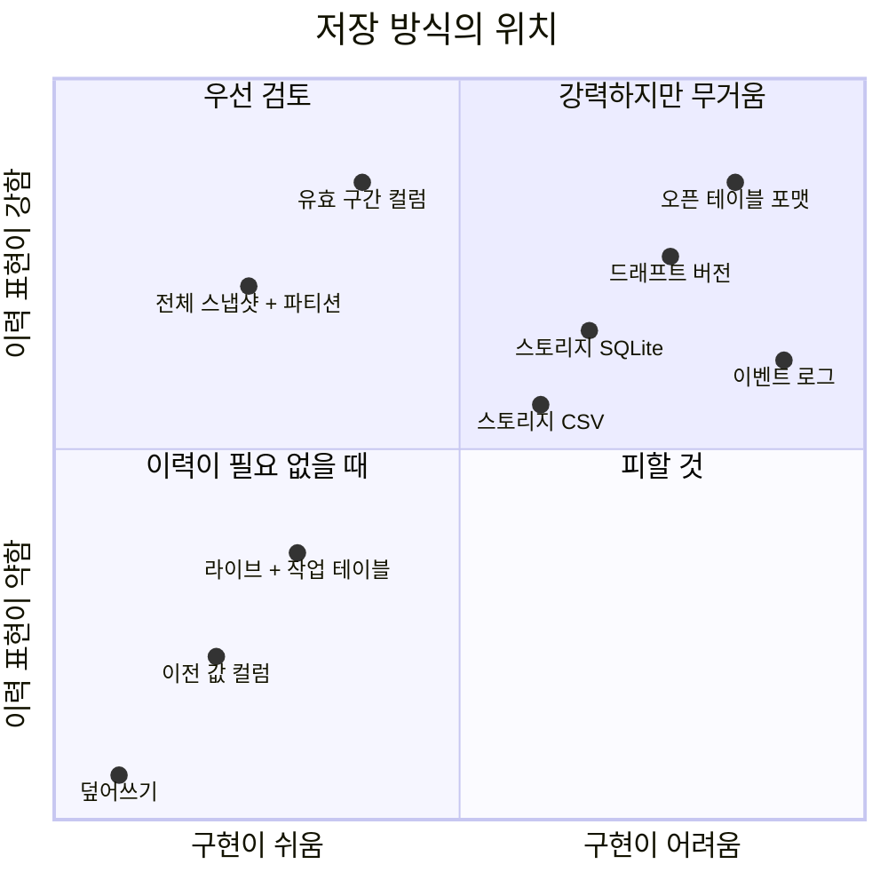
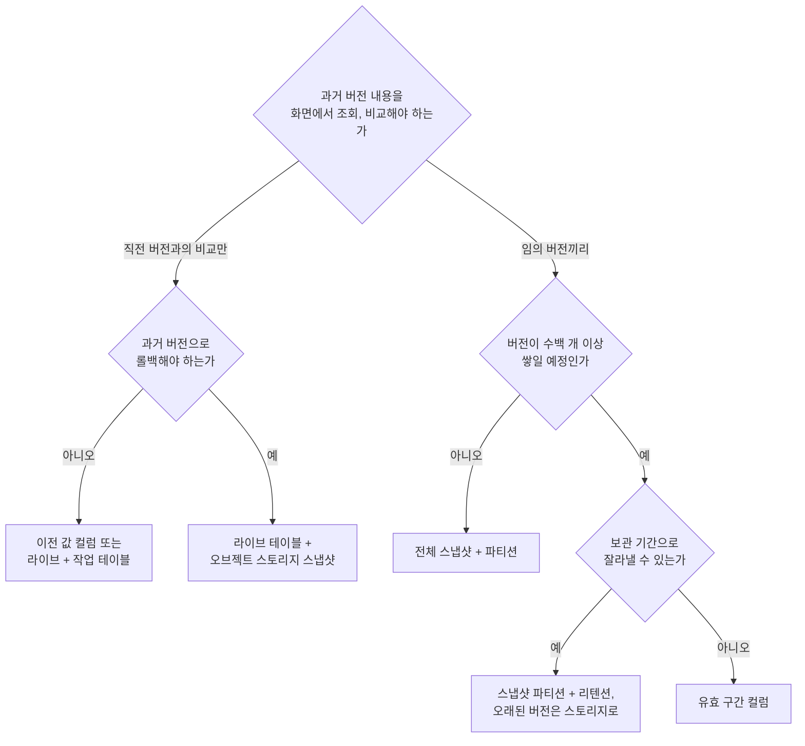

# 대안 비교

버전 이력을 저장하는 대안들을 같은 기준으로 나란히 놓고, 요구사항에 따라 어떤 조합이 되는지 정리한다.

## 평가 기준

- 변경 확인: 발행 직전에 직전 버전과의 차이를 구하기 쉬운 정도
- 임의 버전 비교: 서로 떨어진 두 버전을 골라 비교하기 쉬운 정도
- 롤백: 과거 버전의 내용을 온전히 다시 얻을 수 있는지 여부
- 저장량 증가: 버전이 쌓일 때 저장량이 늘어나는 속도
- 구현 난이도: 테이블 구조, 쿼리, 부가 절차를 포함한 구현과 운영의 복잡도

## 저장 방식 비교표

| 방식 | 변경 확인 | 임의 버전 비교 | 롤백 | 저장량 증가 | 구현 난이도 |
|---|---|---|---|---|---|
| 덮어쓰기 (SCD Type 1) | 불가 | 불가 | 불가 | 없음 | 매우 낮음 |
| 이전 값 컬럼 (SCD Type 3) | 쉬움 | 불가 | 직전 한 단계만 | 없음 | 낮음 |
| 유효 구간 컬럼 (SCD Type 2) | 쉬움 | 쉬움 | 가능 | 변경량에 비례 | 중간 |
| 전체 스냅샷 + 파티션 | 쉬움 | 쉬움 | 가능 | 전체 크기 × 버전 수 | 낮음 |
| 버전마다 테이블 | 쉬움 | 쉬움 | 가능 | 전체 크기 × 버전 수 | 중간 |
| 라이브 + 작업 테이블 | 쉬움 | 불가 | 불가 (다른 보관소 필요) | 2배로 고정 | 낮음 |
| 드래프트 버전 | 쉬움 | 쉬움 | 가능 | 전체 크기 × 버전 수 | 높음 |
| 오브젝트 스토리지 CSV | 직접 구현 | 직접 구현 | 가능 | 전체 크기 × 버전 수 (단가 낮음) | 중간 |
| 오브젝트 스토리지 SQLite | 내려받은 뒤 SQL | 내려받은 뒤 SQL | 가능 | 전체 크기 × 버전 수 (단가 낮음) | 중간 |
| 오픈 테이블 포맷 | 엔진으로 SQL | 엔진으로 SQL | 가능 | 변경된 파일만큼 | 높음 (운영 요소 추가) |
| 이벤트 로그 | 사건 접기 | 사건 접기 | 재생으로 가능 | 변경 횟수에 비례 | 높음 |

## 구현 난이도와 이력 표현력

두 축으로 펼쳐 보면 왼쪽 위, 즉 구현이 쉬우면서 이력을 충분히 표현하는 영역에 놓인 방식이 우선 검토 대상이 된다.

## 조합 예시

실제 설계는 한 가지 방식만 쓰지 않고, 편집용 저장과 보관용 저장을 나눠 조합한다.

| 조합 | 편집 상태 | 버전 보관 | 변경 확인 방법 | 어울리는 상황 |
|---|---|---|---|---|
| 최소 구성 | 라이브 테이블 하나 | 오브젝트 스토리지 파일 | 직전 버전 파일을 임시 테이블에 올려 SQL 비교 | 직전 버전 대비 확인만 필요하고 빠르게 만들어야 할 때 |
| DB 중심 | 작업 테이블 | 유효 구간 테이블 또는 스냅샷 파티션 | 테이블 간 SQL 비교 | 과거 버전을 화면에서 자주 조회하고 비교할 때 |
| 계층 혼합 | 작업 테이블 | 최근 N개는 DB, 그 이전은 오브젝트 스토리지 | 최근 버전은 SQL, 오래된 버전은 내려받아 비교 | 버전이 많이 쌓이고 오래된 버전은 드물게 볼 때 |
| 플랫폼 활용 | 작업 테이블 | 오픈 테이블 포맷 | 쿼리 엔진의 타임 트래블 | 데이터 플랫폼에 테이블 포맷이 이미 운영될 때 |

- 어느 조합이든 공통으로 필요한 것
  - 배포용 사전 파일은 버전별로 고정된 경로에 보관
  - 클러스터마다 어느 버전을 쓰는지 가리키는 매핑 테이블
  - 버전 번호, 생성자, 생성 시각, 파일 위치를 담는 버전 메타데이터 테이블

## 고르는 순서

요구사항을 순서대로 확인하면 선택지가 좁혀진다.

- 판단을 미뤄도 되는 것
  - 임의 버전 비교: 버전별 파일만 보관되어 있으면 나중에 어떤 방식으로든 추가 가능
  - 오래된 버전의 계층 이동: 버전 수가 실제로 문제가 될 때 도입해도 늦지 않음
- 처음부터 정해야 하는 것
  - 버전의 단위와 번호 체계: 나중에 바꾸면 모든 이력의 해석이 달라짐
  - 편집과 발행의 경계: 저장이 곧 배포인 구조에서 분리된 구조로 옮기는 일은 운영 방식의 변경을 동반함
  - 발행된 버전의 불변성: 한 번 허용한 수정은 이후 모든 비교와 롤백의 신뢰를 무너뜨림
