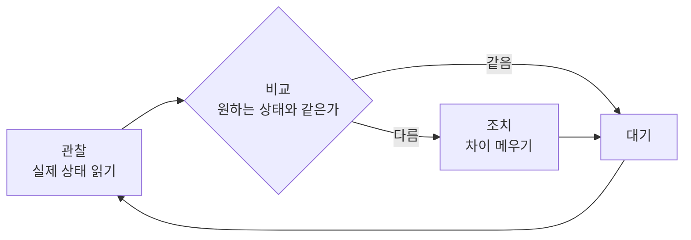
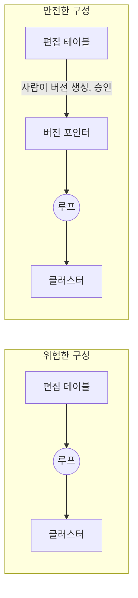
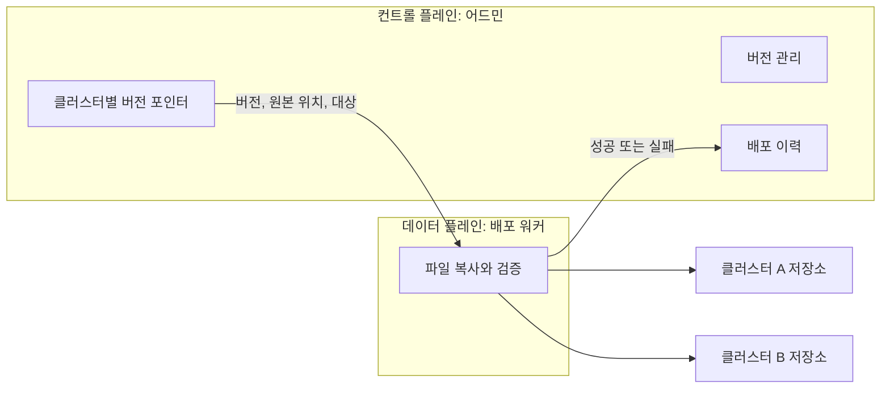

# 원하는 상태와 조정 루프

"무엇을 해라"가 아니라 "어떤 상태여야 한다"를 기록하고, 시스템이 실제 상태를 거기에 맞춰 가는 운영 방식이다. 클러스터가 여러 개이고 각각 다른 사전 버전을 쓸 수 있는 환경에서 배포 상태를 관리하는 기본 틀이 된다.

## 명령형과 선언형

배포를 표현하는 방법은 두 가지다. 명령형(Imperative)은 수행할 동작을 기록하고, 선언형(Declarative)은 도달해야 할 결과를 기록한다.

| 항목 | 명령형 | 선언형 |
|---|---|---|
| 기록하는 것 | "클러스터 A에 버전 12를 복사하라" | "클러스터 A는 버전 12여야 한다" |
| 실패했을 때 | 명령이 사라지므로 누군가 다시 내려야 함 | 목표가 남아 있으므로 다시 맞추면 됨 |
| 현재 상태 파악 | 지금까지의 명령 이력을 따라가야 함 | 기록된 목표를 읽으면 됨 |
| 새 클러스터 추가 | 과거 명령을 다시 실행해야 함 | 목표만 지정하면 됨 |

- 선언형의 핵심 용어
  - 원하는 상태(Desired state): 운영자가 지정한 목표
  - 실제 상태(Actual state): 시스템에 지금 적용되어 있는 것
  - 드리프트(Drift): 두 상태가 어긋나 있는 것

## 원하는 상태 포인터

사전 배포에서 원하는 상태는 "클러스터 → 버전"의 매핑 테이블 하나로 표현된다. 사전 내용을 담지 않고 어느 버전을 가리키는지만 담기 때문에 포인터라고 부른다.

| cluster | desired_version | applied_version | status |
|---|---|---|---|
| A | 12 | 12 | 적용 완료 |
| B | 12 | 11 | 배포 중 |
| C | 10 | 10 | 적용 완료 |

- 이 테이블로 표현되는 동작
  - 배포: `desired_version`을 새 버전 번호로 변경
  - 롤백: `desired_version`을 이전 버전 번호로 변경
  - 클러스터별 다른 버전: 행마다 다른 값
  - 배포 진행 상황: `desired_version`과 `applied_version`의 차이
- 내용과 포인터를 분리한 효과
  - 클러스터가 몇 개로 늘어나도 사전 내용의 저장량은 그대로임
  - 배포와 롤백이 같은 종류의 연산이 됨
- 같은 발상의 다른 예
  - 검색 엔진의 인덱스 별칭: 별칭이 가리키는 인덱스를 바꿔 무중단 교체
  - 심볼릭 링크: `current`가 가리키는 디렉터리를 바꿔 릴리스 전환
  - Git 브랜치: 커밋을 가리키는 이름표

## 조정 루프

조정 루프(Reconciliation loop)는 원하는 상태와 실제 상태를 주기적으로 비교해 차이가 있으면 메우는 반복 작업이다. 쿠버네티스의 컨트롤러와 GitOps 도구의 자동 동기화가 이 구조로 동작한다.

- 성질
  - 자가 복구: 조치가 실패해도 다음 주기에 다시 비교하고 재시도
  - 누락 내성: 변경 알림을 한 번 놓쳐도 상태를 직접 비교하므로 결국 맞춰짐
  - 수렴: 몇 번을 실행해도 원하는 상태에 도달하면 더 이상 아무 일도 하지 않음
- 사건 기반 방식과의 차이
  - 사건 기반(Edge-triggered): "바뀌었다"는 신호에 반응. 신호를 놓치면 어긋난 채로 남음
  - 상태 기반(Level-triggered): "지금 어떤가"를 보고 반응. 조정 루프가 여기에 해당함

## 루프의 입력을 무엇으로 둘 것인가

조정 루프의 안전성은 무엇을 원하는 상태로 삼느냐에 달려 있다. 주기적으로 사전을 발행하는 크론 작업은 조정 루프의 한 형태이며, 입력에 따라 전혀 다른 시스템이 된다.

| 루프가 원하는 상태로 삼는 것 | 결과 |
|---|---|
| 편집 중인 원본 테이블 | 저장이 곧 배포. 작업 중이던 내용과 실수가 다음 주기에 그대로 나감 |
| 승인된 버전을 가리키는 포인터 | 사람이 포인터를 바꾼 것만 나감. 루프는 실패한 배포를 다시 맞추는 역할만 수행 |

- GitOps에서의 같은 구분
  - 루프의 입력은 작업 브랜치가 아니라 리뷰를 거쳐 합쳐진 주 브랜치
  - 승인 지점이 루프 앞에 있기 때문에 자동 동기화가 안전해짐
- 루프 없이 가는 선택
  - 포인터 변경 시점에 한 번만 배포를 실행하고 주기 실행을 두지 않는 구성도 가능
  - 이 경우 실패한 배포의 재시도와 드리프트 감지를 별도로 마련해야 함

## 컨트롤 플레인과 데이터 플레인

원하는 상태를 결정하는 쪽과 그 상태를 실제로 만드는 쪽을 분리하는 구조다. 결정하는 쪽을 컨트롤 플레인(Control plane), 실행하는 쪽을 데이터 플레인(Data plane)이라고 부른다.

- 역할 구분
  - 컨트롤 플레인: 버전 생성, 승인, 어느 클러스터에 무엇을 배포할지 결정, 결과 기록
  - 데이터 플레인: 전달받은 작업을 그대로 수행하고 결과를 보고
- 분리의 이점
  - 권한 최소화: 여러 클러스터의 저장소에 쓰는 권한을 워커에만 부여하고 어드민에는 주지 않음
  - 단순한 실행기: 워커가 판단을 하지 않으므로 요구사항이 바뀌어도 고칠 일이 적음
  - 부하 격리: 대용량 파일 처리가 어드민 서버의 응답 속도에 영향을 주지 않음
  - 수동 개입 가능: 어드민이 멈춰도 같은 입력으로 워커를 직접 실행 가능
- 둘 사이의 계약으로 정해 둘 것
  - 워커 입력: 버전, 원본 파일 위치, 대상 클러스터와 경로, 작업 식별자
  - 워커 출력: 성공 여부, 실패 원인, 적용된 파일의 체크섬
  - 워커는 계약 밖의 정보(편집 테이블 등)를 직접 읽지 않음

## 푸시와 풀

변경을 대상에 전달하는 방향에도 두 가지가 있다.

| 항목 | 푸시(Push) | 풀(Pull) |
|---|---|---|
| 방향 | 중앙이 대상에 밀어 넣음 | 대상 쪽에서 중앙의 상태를 읽어 가져감 |
| 필요한 권한 | 중앙이 모든 대상에 대한 쓰기 권한 보유 | 대상이 중앙에 대한 읽기 권한만 보유 |
| 반영 시점 | 중앙이 정한 시점에 즉시 | 대상의 확인 주기에 따름 |
| 대상 추가 | 중앙에 대상을 등록해야 함 | 대상이 스스로 읽기 시작하면 됨 |

- 푸시가 맞는 경우: 배포 시점과 순서를 중앙에서 통제해야 할 때
- 풀이 맞는 경우: 대상이 많고 계속 늘어나며 중앙에 넓은 권한을 모으기 어려울 때
- 혼합 형태: 파일은 푸시로 배치하고, 어느 버전을 쓸지는 대상이 작업 직전에 중앙에 물어보는 구성
