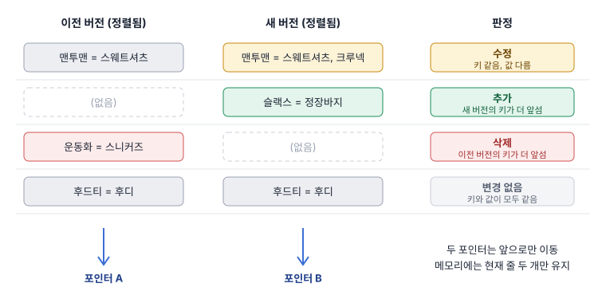

# diff 기법

두 버전 사이에서 추가된 행, 삭제된 행, 수정된 행을 찾아내는 방법이다. 버전 관리의 가치는 "무엇이 바뀌는지 보고 결정할 수 있다"는 데 있으므로, 저장 방식을 고를 때 비교를 어떻게 구현할지가 함께 결정되어야 한다.

## 변경의 세 종류

사전의 비교는 텍스트 파일의 줄 비교와 성격이 다르다. 표제어라는 키가 있기 때문에 줄의 순서는 의미가 없고, 같은 키끼리 짝을 지어 값을 비교하는 집합 비교가 된다.

이전 버전

| term | synonyms |
|---|---|
| 후드티 | 후디 |
| 맨투맨 | 스웨트셔츠 |
| 운동화 | 스니커즈 |

새 버전

| term | synonyms |
|---|---|
| 후드티 | 후디 |
| 맨투맨 | 스웨트셔츠, 크루넥 |
| 슬랙스 | 정장바지 |

비교 결과

| 종류 | 판정 조건 | 해당 행 |
|---|---|---|
| 추가 | 키가 새 버전에만 있음 | 슬랙스 |
| 삭제 | 키가 이전 버전에만 있음 | 운동화 |
| 수정 | 키가 양쪽에 있고 값이 다름 | 맨투맨 |
| 변경 없음 | 키가 양쪽에 있고 값이 같음 | 후드티 |

- 키 선정이 결과를 좌우함
  - 표제어를 키로 쓰면 표제어 자체를 고친 경우가 "삭제 1건 + 추가 1건"으로 나타남
  - 행 고유 번호를 키로 쓰면 같은 경우가 "수정 1건"으로 나타남
- 값 비교 전 정규화
  - 동의어 순서, 앞뒤 공백, 대소문자처럼 의미가 같은 차이를 변경으로 볼지 미리 결정
  - 정규화 없이 비교하면 의미 없는 수정이 대량으로 표시됨

## SQL로 비교

두 버전이 모두 DB 안에 있다면 조인 하나로 끝난다. 양쪽 어디에든 있는 키를 모두 남기는 `FULL OUTER JOIN`이 세 종류의 변경을 한 번에 찾아 준다.

```sql
SELECT
    COALESCE(o.term, n.term) AS term,
    o.synonyms               AS before,
    n.synonyms               AS after,
    CASE
        WHEN o.term IS NULL THEN '추가'
        WHEN n.term IS NULL THEN '삭제'
        ELSE '수정'
    END AS change
FROM (SELECT * FROM dictionary_snapshot WHERE version = 11) o
FULL OUTER JOIN
     (SELECT * FROM dictionary_snapshot WHERE version = 12) n
  ON o.term = n.term
WHERE o.term IS NULL
   OR n.term IS NULL
   OR o.synonyms IS DISTINCT FROM n.synonyms;
```

- `IS DISTINCT FROM`: 한쪽이 NULL이어도 올바르게 "다름"으로 판정하는 비교 연산
- `EXCEPT`를 쓰는 간단한 방법
  - `새 버전 EXCEPT 이전 버전`은 추가되거나 수정된 행의 새 값
  - `이전 버전 EXCEPT 새 버전`은 삭제되거나 수정된 행의 옛 값
  - 수정을 한 줄로 묶어 보여주려면 결국 키로 다시 짝지어야 함
- 성능
  - 양쪽 모두 키에 인덱스가 있으면 수십만 행은 1초 안팎
  - 결과에 `ORDER BY`와 `LIMIT`을 붙여 페이지 단위로 조회 가능

## 정렬-병합 비교

두 버전이 파일로 있고 메모리에 다 올릴 수 없을 때의 표준 기법이다. 양쪽을 같은 키로 정렬해 두고, 각 파일의 맨 앞에서 시작해 한 줄씩 나란히 읽어 내려간다.



```python
a, b = next(old, None), next(new, None)
while a or b:
    if b is None or (a and a.term < b.term):
        yield ("삭제", a); a = next(old, None)
    elif a is None or b.term < a.term:
        yield ("추가", b); b = next(new, None)
    else:
        if a.synonyms != b.synonyms:
            yield ("수정", a, b)
        a, b = next(old, None), next(new, None)
```

- 동작 원리
  - 두 키가 같으면 값을 비교하고 양쪽 포인터를 모두 전진
  - 한쪽 키가 더 앞서면 그 키는 반대편에 없다는 뜻이므로 그쪽 포인터만 전진
  - 정렬되어 있으므로 지나간 줄을 다시 볼 일이 없음
- 특성
  - 메모리 사용량이 파일 크기와 무관하게 일정함
  - 파일을 일정 크기씩 끊어 읽는 청크 단위 처리와 자연스럽게 결합됨
  - 각 파일을 처음부터 끝까지 한 번만 읽음
- 전제 조건
  - 두 파일이 완전히 같은 규칙으로 정렬되어 있어야 함
  - 정렬 규칙이 DB의 문자열 정렬과 프로그래밍 언어의 문자열 비교에서 다를 수 있으므로, 한글과 대소문자가 섞인 키는 바이트 순서로 통일하는 편이 안전함
  - 정렬되지 않은 파일은 먼저 외부 정렬(External sort)로 정렬한 뒤 비교

## 해시를 이용한 비교

해시(Hash)는 내용을 고정 길이의 짧은 값으로 요약한 것으로, 내용이 같으면 해시가 같다는 성질을 비교에 활용한다.

- 해시 맵 비교
  - 이전 버전을 `키 → 값` 맵으로 메모리에 올리고 새 버전을 한 줄씩 대조
  - 정렬이 필요 없고 구현이 가장 짧음
  - 한쪽 전체가 메모리에 올라가므로 수십만 행 수준까지 적합
- 행 해시
  - 값 컬럼이 여러 개일 때 전체를 이어 붙여 해시한 값을 컬럼으로 저장
  - 수정 여부 판정이 컬럼 하나의 비교로 단순해짐
- 파일 체크섬
  - 파일 전체의 해시가 같으면 내용 비교 없이 "변경 없음"으로 판정
  - 변경이 없는 발행을 빠르게 걸러 내는 첫 관문으로 유용
- 구간 해시
  - 키 범위별로 해시를 구해 두고, 해시가 다른 구간만 상세 비교
  - 구간 해시를 다시 묶어 트리로 만든 것이 머클 트리(Merkle tree)이며, 원격지 사이의 대용량 동기화에 쓰임

## 결과를 보여주는 방법

비교 결과는 계산하는 것만큼 보여주는 방식이 중요하다. 사람이 읽고 승인 여부를 판단하는 화면이기 때문이다.

- 요약 먼저
  - 추가, 삭제, 수정 건수를 맨 위에 표시
  - 건수가 평소보다 비정상적으로 크면 경고를 띄워 일괄 삭제 같은 사고를 걸러 냄
- 수정 건의 표현
  - 수정 전과 후를 나란히 배치
  - 동의어 목록 안에서 추가되고 빠진 항목까지 강조하면 판단이 빨라짐
- 결과의 저장
  - 비교 결과를 테이블이나 파일로 저장해 두면 페이지 이동마다 다시 계산하지 않아도 됨
  - 발행된 버전은 바뀌지 않으므로 한 번 계산한 결과는 영구히 유효함
- 대량 변경
  - 수만 건의 변경은 목록 대신 내려받기 파일로 제공

## 방식 고르기

| 데이터가 있는 곳 | 규모 | 적합한 기법 |
|---|---|---|
| 두 버전 모두 DB | 무관 | SQL 조인 |
| 유효 구간 컬럼이 있는 테이블 | 무관 | 구간 경계 조건 조회 |
| 한쪽은 DB, 한쪽은 파일 | 수십만 행 이하 | 파일을 임시 테이블에 적재 후 SQL 조인 |
| 두 버전 모두 파일 | 메모리에 들어감 | 해시 맵 비교 |
| 두 버전 모두 파일 | 메모리를 넘음 | 정렬-병합 비교 |
| 변경 사건 로그 | 무관 | 표제어별 사건 접기 |
