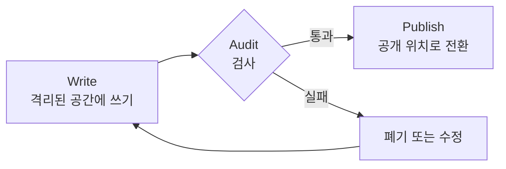
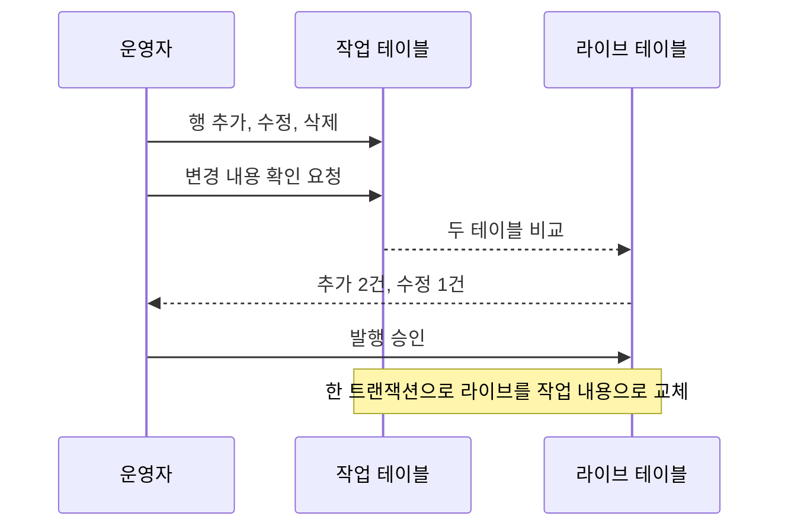
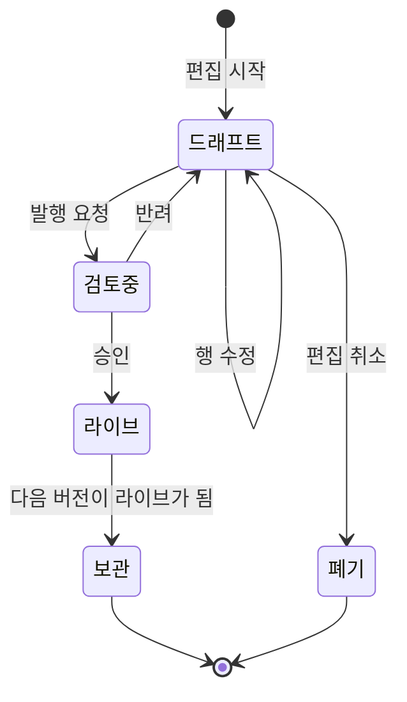
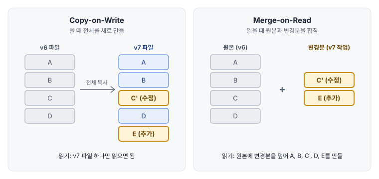

# 드래프트와 발행 분리

편집 중인 내용과 배포된 내용 사이에 경계를 두는 패턴 모음이다. 저장 버튼을 누르는 것과 검색에 반영되는 것이 같은 사건이 되지 않도록, 그 사이에 확인 단계가 들어갈 자리를 만든다.

## 분리가 필요한 이유

편집 대상과 배포 대상이 같은 데이터라면 저장하는 순간이 곧 배포다. 스프레드시트를 원본으로 두고 주기적으로 읽어 가는 구조가 대표적이며, 다음 문제가 따라온다.

- 작업 중 노출: 여러 건을 고치는 도중의 반쯤 완성된 상태가 배포될 수 있음
- 실수의 즉시 반영: 오타나 잘못 지운 행이 확인 절차 없이 검색에 반영됨
- 변경 단위의 부재: 무엇이 한 묶음의 변경인지 정의되지 않아 되돌릴 단위도 없음
- 검토 불가: 다른 사람이 변경 내용을 보고 승인할 지점이 존재하지 않음

## Write-Audit-Publish

WAP(Write-Audit-Publish)은 데이터를 공개하기 전에 격리된 곳에 먼저 쓰고, 검사를 통과한 것만 공개하는 3단계 패턴이다. 데이터 파이프라인의 품질 관리 기법으로 알려졌고, 소프트웨어의 "빌드 → 테스트 → 배포"와 같은 구조다.

- Write
  - 운영 중인 데이터와 분리된 공간(작업 테이블, 드래프트 버전, 브랜치)에 변경을 기록
  - 이 단계의 데이터는 서비스가 읽지 않음
- Audit
  - 자동 검사: 문법 오류, 중복 표제어, 순환 동의어, 변경 건수의 비정상적 급증
  - 사람 검사: 직전 버전 대비 변경 내용을 보고 승인
  - 실행 검사: 실제 분석기에 사전을 올려 로딩 성공 여부 확인
- Publish
  - 검사를 통과한 데이터를 공개 위치로 한 번에 전환
  - 전환은 중간 상태가 보이지 않도록 원자적으로 수행

## 스테이징 테이블과 스왑

가장 직관적인 구현은 테이블을 두 벌 두는 것이다. 운영자는 작업 테이블만 고치고, 서비스는 라이브 테이블만 읽는다.

- 발행 구현 방법
  - 내용 교체: 한 트랜잭션 안에서 라이브를 비우고 작업 테이블 내용을 복사
  - 이름 교체: 새 테이블을 만든 뒤 테이블 이름을 맞바꿈
- 장점
  - 구조가 단순하고 라이브 조회 쿼리가 평범한 형태로 유지됨
  - 변경 확인이 두 테이블 비교로 끝남
- 단점
  - 두 사람이 동시에 편집하면 작업 테이블에서 서로의 변경이 섞임
  - 과거 버전을 작업 테이블로 불러오면 진행 중이던 편집이 사라짐
  - 직전 상태만 남으므로 더 오래된 버전은 다른 저장소가 맡아야 함

## 드래프트 버전

콘텐츠 관리 시스템이 글의 "임시 저장"과 "게시"를 다루는 방식을 테이블에 적용한 것이다. 테이블은 하나만 두고, 각 행에 버전 번호와 버전의 상태를 붙인다.

버전 6이 라이브인 상태에서 편집을 시작하면 드래프트 버전 7이 만들어지고, 바뀐 행만 7번으로 기록된다.

| version | status | term | synonyms |
|---|---|---|---|
| 6 | 라이브 | 후드티 | 후디 |
| 6 | 라이브 | 맨투맨 | 스웨트셔츠 |
| 6 | 라이브 | 운동화 | 스니커즈 |
| 7 | 드래프트 | 맨투맨 | 스웨트셔츠, 크루넥 |
| 7 | 드래프트 | 슬랙스 | 정장바지 |

- 편집 중 화면 표시
  - 라이브 행을 바탕으로 깔고 같은 표제어의 드래프트 행이 있으면 그것으로 대체
  - 삭제는 "삭제됨" 표시가 붙은 드래프트 행으로 기록
- 변경 확인
  - 드래프트 버전의 행 목록이 곧 변경 목록
  - 같은 표제어의 라이브 행과 나란히 놓으면 수정 전후가 됨
- 발행
  - 드래프트에 없는 라이브 행을 새 버전 번호로 채워 완전한 버전을 완성
  - 상태를 라이브로 바꾸고 이전 버전은 보관 상태로 전환
- 주의점
  - 상태 전이를 코드 곳곳에서 직접 바꾸면 불가능한 상태가 생기므로 전이 규칙을 한곳에 모아야 함
  - 드래프트의 기준이 된 라이브 버전 번호를 기록해 두어야 발행 시점에 기준이 바뀌었는지 확인 가능

## Copy-on-Write와 Merge-on-Read

드래프트 버전 방식은 편집 중과 발행 후에 서로 다른 저장 전략을 쓴다. 이 두 전략에는 이름이 있고, 대용량 테이블 저장 기술에서도 같은 용어로 쓰인다.

| 항목 | Copy-on-Write | Merge-on-Read |
|---|---|---|
| 쓰기 비용 | 큼. 한 행을 바꿔도 전체를 다시 씀 | 작음. 바뀐 행만 기록 |
| 읽기 비용 | 작음. 완성본을 그대로 읽음 | 큼. 읽을 때마다 원본과 변경분을 병합 |
| 저장량 | 버전마다 전체 크기 | 원본 + 변경분 |
| 어울리는 상황 | 읽기가 많고 쓰기가 드묾 | 쓰기가 잦고 읽기가 드묾 |

- 편집 중: 저장이 잦고 읽는 주체는 편집 화면뿐이므로 Merge-on-Read가 적합
- 발행 후: 수정이 없고 배포와 비교에서 반복해서 읽히므로 Copy-on-Write가 적합
- 컴팩션(Compaction): 쌓인 변경분을 원본에 합쳐 완성본을 다시 만드는 작업. 드래프트를 발행하는 순간이 컴팩션에 해당함
