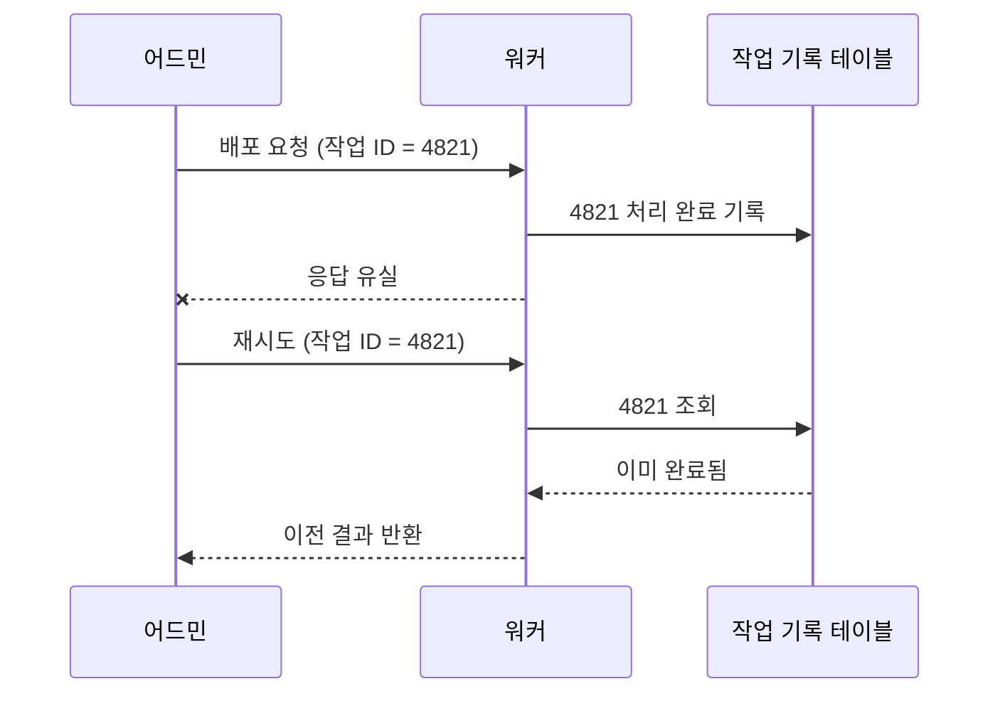
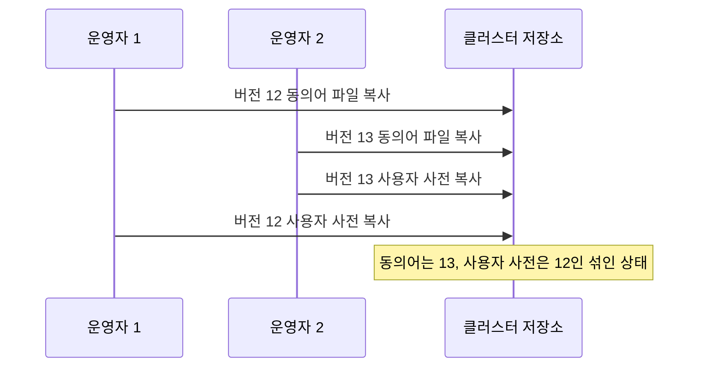
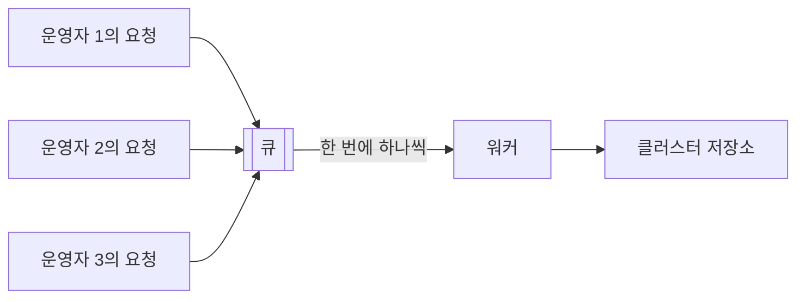

# 멱등성과 직렬 실행

배포 작업은 실패할 수 있고, 여러 사람이 동시에 요청할 수 있다. 다시 실행해도 안전하게 만드는 성질이 멱등성이고, 동시에 실행되어도 섞이지 않게 만드는 장치가 직렬 실행과 락이다.

## 멱등성

멱등성(Idempotency)은 같은 작업을 한 번 하든 여러 번 하든 결과가 같은 성질이다. 분산 환경에서는 "요청이 실패한 것인지, 성공했는데 응답만 못 받은 것인지"를 구분할 수 없는 경우가 많아서, 안전하게 다시 시도할 수 있는지가 설계의 기본 조건이 된다.

| 멱등한 작업 | 멱등하지 않은 작업 |
|---|---|
| 값을 12로 설정 | 값을 1 증가 |
| 파일을 지정된 경로에 덮어쓰기 | 파일 끝에 내용 덧붙이기 |
| 키가 있으면 갱신, 없으면 삽입 | 무조건 새 행 삽입 |
| "버전 12여야 한다"고 상태 지정 | "다음 버전으로 올려라"고 명령 |

- 멱등성이 필요한 이유
  - 재시도: 타임아웃 뒤의 재시도가 중복 반영으로 이어지지 않음
  - 최소 한 번 전달(At-least-once delivery): 작업 큐와 스케줄러는 같은 작업을 두 번 넘겨줄 수 있음
  - 수동 복구: 중간에 멈춘 작업을 처음부터 다시 돌려도 됨

## 멱등하게 만드는 기법

작업 자체의 성질을 바꾸거나, 이미 처리했다는 사실을 기억해 두는 두 갈래가 있다.



- 멱등 키(Idempotency key)
  - 요청마다 고유한 식별자를 붙이고, 처리한 식별자를 기록
  - 같은 식별자가 다시 오면 작업을 반복하지 않고 저장된 결과를 반환
- 결과 기준 확인
  - 실행 전에 목표가 이미 달성되어 있는지 확인하고 달성되어 있으면 건너뜀
  - 대상 경로에 같은 체크섬의 파일이 있으면 복사를 생략
- 원자적 교체
  - 임시 위치에 완전히 쓴 뒤 마지막에 한 번의 연산으로 최종 위치에 노출
  - 중간에 실패하면 최종 위치에는 아무 흔적이 남지 않아 다시 실행해도 됨
- 조건부 갱신
  - 상태가 기대한 값일 때만 바꾸도록 조건을 붙임
  - `UPDATE … SET status = '완료' WHERE id = 4821 AND status = '진행중'`은 두 번 실행해도 한 번만 적용됨
- 절대값으로 표현
  - "증가"나 "다음" 같은 상대적 표현 대신 최종 값을 직접 지정

## 경쟁 상태

경쟁 상태(Race condition)는 둘 이상의 작업이 겹쳐 실행되면서 실행 순서에 따라 결과가 달라지는 문제다. 각 작업은 혼자 실행하면 올바르지만 섞이면 어느 쪽도 의도하지 않은 결과가 나온다.



- 사전 배포에서 발생하는 지점
  - 같은 클러스터에 대한 배포 두 건이 겹침
  - 배포가 진행되는 도중에 롤백이 요청됨
  - 발행용 파일을 만드는 도중에 원본이 편집됨
- 해결의 방향
  - 겹치지 않게 줄을 세우는 방법: 직렬 실행
  - 겹치는 것을 막거나 감지하는 방법: 락

## 직렬 큐

작업을 큐에 넣고 한 번에 하나씩만 꺼내 실행하면 겹침 자체가 사라진다. 요청은 동시에 들어와도 실행은 도착 순서대로 이루어진다.



워크플로 도구에서는 설정 한 줄로 구현된다. Airflow의 경우 DAG의 동시 실행 수를 1로 제한한다.

```python
with DAG(
    dag_id="dictionary_deploy",
    schedule=None,          # 외부 트리거로만 실행
    max_active_runs=1,      # 동시에 한 건만 실행, 나머지는 대기
    catchup=False,
):
    ...
```

- 장점
  - 락을 직접 다루지 않아도 겹침이 원천적으로 차단됨
  - 실행 순서가 큐의 순서로 명확하게 남음
- 단점
  - 앞 작업이 오래 걸리면 뒤 작업이 모두 기다림
  - 서로 무관한 클러스터의 배포까지 한 줄로 서게 됨
- 조정 방법
  - 큐를 클러스터 단위로 나누어 같은 클러스터끼리만 직렬화
  - 대기 중인 요청이 있을 때 같은 대상의 이전 요청을 취소하고 최신 요청만 남기는 정책 검토

## 락

락(Lock)은 공유 자원에 대한 접근을 조정하는 장치다. 충돌을 미리 막는 방식과, 일단 진행하고 충돌을 나중에 감지하는 방식으로 나뉜다.

| 항목 | 비관적 락 | 낙관적 락 |
|---|---|---|
| 가정 | 충돌이 자주 일어난다 | 충돌이 드물다 |
| 방식 | 작업 전에 자원을 선점하고 나머지는 기다림 | 작업 후 반영 시점에 그사이 변경이 있었는지 검사 |
| 충돌 시 | 뒤에 온 쪽이 대기 | 뒤에 반영하는 쪽이 실패하고 다시 시도 |
| 위험 | 락을 쥔 쪽이 죽으면 해제되지 않을 수 있음 | 충돌이 잦으면 재시도가 반복됨 |
| 어울리는 작업 | 길고 무거운 작업: 배포, 발행 파일 생성 | 짧은 갱신: 포인터 변경, 행 편집 |

- 비관적 락의 구현
  - DB 행 잠금: `SELECT … FOR UPDATE`로 트랜잭션이 끝날 때까지 해당 행을 선점
  - 권고 락(Advisory lock): DB가 제공하는 이름 기반 락으로, 특정 행이 아닌 "배포 중"이라는 개념을 잠금
  - 분산 락: 여러 서버가 공유하는 저장소에 만료 시간이 있는 키를 두어 선점
- 낙관적 락의 구현
  - 행에 개정 번호를 두고, 읽을 때의 번호와 같을 때만 갱신

```sql
UPDATE cluster_dictionary_version
SET desired_version = 12,
    revision = revision + 1
WHERE cluster = 'A'
  AND revision = 7;
```

- 갱신된 행이 0건이면 그사이 다른 사람이 먼저 바꿨다는 뜻이므로, 최신 상태를 다시 보여주고 확인을 요청
- 락 설계 시 주의점
  - 만료 시간: 락을 쥔 프로세스가 죽어도 풀리도록 시간 제한을 둠
  - 표시: 누가 무엇 때문에 잠갔는지 화면에 보여주어 기다리는 사람이 상황을 알 수 있게 함
  - 범위: 전체가 아니라 클러스터나 사전 종류처럼 실제로 충돌하는 단위로 좁힘

## 선택 기준

| 상황 | 적합한 장치 |
|---|---|
| 같은 요청이 두 번 올 수 있음 | 멱등 키, 결과 기준 확인 |
| 무거운 배포 작업이 겹칠 수 있음 | 직렬 큐 |
| 두 사람이 같은 값을 동시에 바꿀 수 있음 | 낙관적 락 |
| 발행 파일 생성 중 원본 편집을 막아야 함 | 비관적 락 또는 한 트랜잭션 안에서의 일관된 읽기 |
| 실패한 작업을 사람이 다시 실행함 | 원자적 교체로 만든 멱등한 작업 |

- 멱등성과 직렬 실행은 서로를 대체하지 않음
  - 직렬 실행만 있으면 재시도 때 중복 반영이 생길 수 있음
  - 멱등성만 있으면 서로 다른 두 작업이 섞이는 것을 막지 못함
