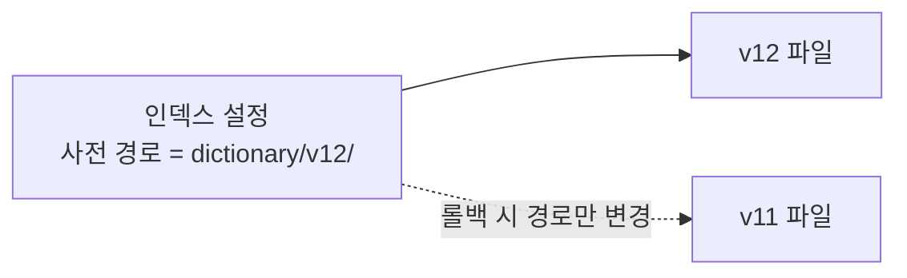
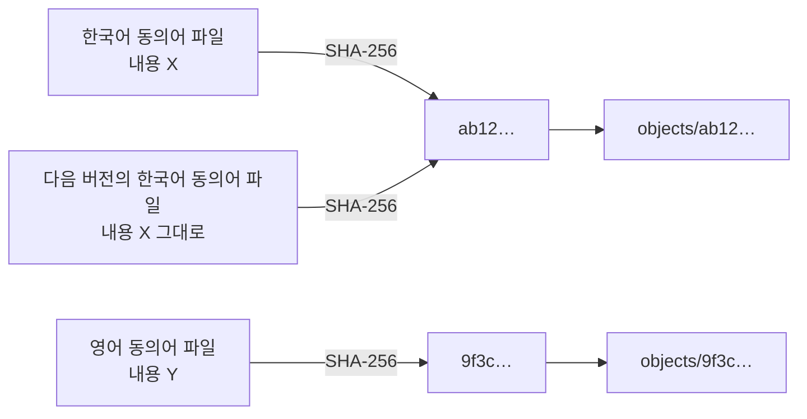
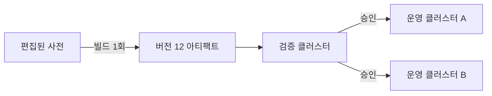

# 불변 아티팩트와 내용 주소 저장

한 번 만든 산출물은 절대 고치지 않고, 바뀌면 새 이름으로 새로 만든다는 원칙이다. 사전 파일을 같은 경로에 덮어쓰던 구조에서 버전 관리 구조로 넘어갈 때 가장 먼저 바뀌는 부분이다.

## 덮어쓰기의 문제

아티팩트(Artifact)는 빌드의 결과로 나온 배포 가능한 산출물을 뜻하며, 사전에서는 검색 엔진이 읽는 사전 파일이 여기에 해당한다. 이 파일을 항상 같은 경로에 덮어쓰면 경로는 하나인데 내용은 시점마다 달라진다.

| 상황 | 같은 경로에 덮어쓰기 | 버전마다 새 경로 |
|---|---|---|
| 쓰는 도중에 읽힘 | 반쯤 쓰인 파일이 읽힐 수 있음 | 다 쓴 뒤에야 경로가 알려지므로 발생하지 않음 |
| 롤백 | 이전 내용이 사라져 불가능 | 이전 경로를 다시 가리키면 끝 |
| 배포 상태 확인 | 경로만으로는 어느 버전인지 알 수 없음 | 경로가 곧 버전 |
| 캐시 | 같은 이름이라 옛 내용이 남아 있을 수 있음 | 이름이 다르므로 섞이지 않음 |
| 재현 | 지난주에 배포된 내용을 다시 얻을 수 없음 | 언제든 같은 파일을 얻음 |

- 같은 문제의 다른 예
  - 컨테이너 이미지의 `latest` 태그: 같은 이름이 시점마다 다른 이미지를 가리켜 배포 재현이 어려움
  - 버전 번호 없는 라이브러리 파일: 어느 빌드가 올라가 있는지 추적 불가
- 불변성이 주는 것
  - 이름과 내용의 관계가 영구히 고정되어, 이름만 기록해 두면 내용이 보장됨

## 버전 경로

가장 단순한 불변 구현은 경로에 버전 번호를 넣는 것이다. 사전을 읽는 쪽은 고정된 경로 대신 설정으로 전달받은 경로를 읽는다.

```text
dictionary/
├── v11/
│   ├── synonyms.txt
│   └── userdict.txt
└── v12/
    ├── synonyms.txt
    └── userdict.txt
```



- 규칙
  - 한 번 쓴 버전 경로에는 다시 쓰지 않음
  - 경로를 알리는 시점은 파일 쓰기가 모두 끝난 뒤
- 따라오는 과제
  - 읽는 쪽이 경로를 설정으로 받을 수 있어야 함
  - 쓰이지 않는 버전 경로를 정리하는 절차가 필요함

## 내용 주소 저장

내용 주소 저장(Content-addressable storage)은 이름을 사람이 정하지 않고 내용의 해시로 정하는 방식이다. 파일 내용을 해시 함수에 넣어 나온 값이 곧 그 파일의 주소가 된다.



- 성질
  - 중복 제거: 내용이 같으면 주소가 같으므로 한 번만 저장됨
  - 무결성 검증: 받은 파일을 다시 해시해 주소와 비교하면 손상 여부가 드러남
  - 덮어쓰기 불가: 내용이 바뀌면 주소가 바뀌므로 구조적으로 불변임
  - 안전한 재시도: 같은 파일을 두 번 올려도 결과가 같음
- 같은 원리를 쓰는 시스템
  - Git: 파일, 디렉터리, 커밋을 모두 내용 해시로 저장
  - 컨테이너 이미지: 레이어를 해시로 식별해 공통 레이어를 재사용

해시는 사람이 읽을 수 없으므로 "버전 12는 어떤 해시들의 묶음인가"를 적어 둔 매니페스트가 필요하다. 버전은 파일 자체가 아니라 이 목록이 된다.

```json
{
  "version": 12,
  "files": {
    "synonyms/ko": "sha256:ab12…",
    "synonyms/en": "sha256:9f3c…",
    "userdict/ko": "sha256:77d0…"
  }
}
```

- 버전 12에서 한국어 동의어만 바뀌었다면 나머지 두 파일은 버전 11과 같은 해시를 가리킴
- 사전 종류와 언어가 늘어날수록 변경 없는 파일을 다시 만들지 않는 이득이 커짐
- 결정적 빌드(Deterministic build)
  - 같은 입력에서 항상 바이트 단위로 같은 파일이 나와야 해시가 일치함
  - 행 정렬, 줄바꿈 문자, 인코딩, 파일 끝 개행을 고정
  - 생성 시각처럼 매번 달라지는 값을 파일 안에 넣지 않음

## 한 번 만들고 여러 곳에 배포

불변 아티팩트의 실질적인 쓰임새는 빌드와 배포를 분리하는 데 있다. 산출물을 한 번만 만들고, 그 똑같은 산출물을 여러 환경에 차례로 배포하는 방식을 승격(Promotion)이라고 한다.



- 배포할 때마다 다시 만드는 방식의 위험
  - 빌드 사이에 원본이 바뀌면 검증한 것과 다른 내용이 운영에 배포됨
  - 클러스터마다 미묘하게 다른 사전이 올라가도 알아채기 어려움
- 승격 방식이 보장하는 것
  - 검증한 바로 그 파일이 운영에 올라감
  - 승인의 대상이 "버전 12"라는 고정된 실체가 됨
  - 버전을 만들어 두고 배포 시점은 나중에 따로 정할 수 있음

## 정리 정책

불변 저장소는 지우지 않으면 계속 쌓인다. 더 이상 필요 없는 파일을 찾아 지우는 작업을 가비지 컬렉션(Garbage collection)이라고 한다.

- 지워도 되는 파일의 조건
  - 보관 대상인 어떤 버전의 매니페스트에서도 참조되지 않음
  - 어떤 클러스터에서도 현재 사용 중이 아님
- 구현 방식
  - 표시 후 삭제(Mark and sweep): 보관할 버전들의 매니페스트를 모두 읽어 참조되는 해시를 표시하고, 표시되지 않은 파일을 삭제
  - 참조 횟수(Reference counting): 파일마다 참조하는 버전 수를 기록하고 0이 되면 삭제
- 안전장치
  - 방금 올라와 아직 매니페스트에 연결되지 않은 파일이 지워지지 않도록 생성 후 일정 시간이 지난 파일만 삭제 대상에 포함
  - 실제 삭제 전에 삭제 예정 목록만 출력하는 모의 실행 제공
