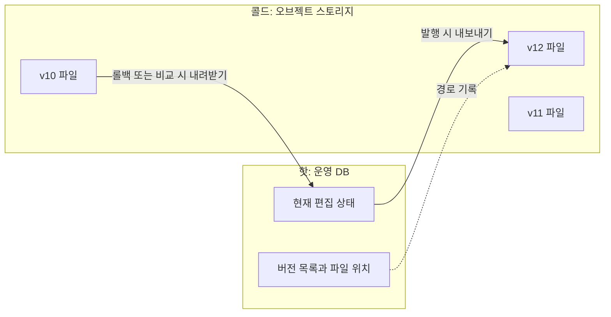
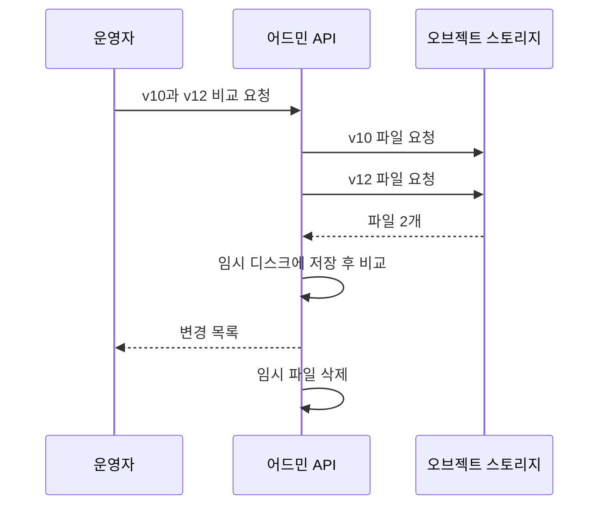

# 오브젝트 스토리지 스냅샷

버전 하나를 파일 하나(또는 한 묶음)로 만들어 S3 같은 오브젝트 스토리지에 올려 두는 방식이다. 운영 DB는 현재 상태만 가볍게 유지하고, 과거 버전의 보관은 저렴한 저장소에 맡긴다.

## 오브젝트 스토리지의 성질

오브젝트 스토리지는 "키 → 파일 덩어리"를 저장하는 거대한 키-값 저장소다. 파일 시스템처럼 보이지만 동작 방식이 달라서, 잘하는 일과 못하는 일이 분명하다.

| 항목 | 관계형 DB | 오브젝트 스토리지 |
|---|---|---|
| 저장 단위 | 행 | 파일(객체) 전체 |
| 부분 수정 | 행 하나만 수정 가능 | 불가. 파일 전체를 다시 올려야 함 |
| 조건 조회 | 인덱스로 즉시 | 불가. 파일을 받아서 직접 찾아야 함 |
| 용량과 비용 | 용량이 늘수록 비용과 관리 부담 증가 | 사실상 무제한, 단가가 매우 낮음 |
| 응답 속도 | 밀리초 | 요청마다 수십~수백 밀리초 |
| 동시 쓰기 | 트랜잭션으로 조정 | 마지막에 올린 것이 이김 |

- 잘 맞는 데이터: 한 번 쓰고 거의 고치지 않으며 통째로 읽는 데이터
- 맞지 않는 데이터: 행 단위로 자주 고치거나 조건으로 검색하는 데이터
- 사전 버전과의 궁합: 발행된 버전은 수정되지 않고 배포할 때 통째로 읽히므로 잘 맞음

## 핫과 콜드 계층

자주 쓰는 데이터는 빠르고 비싼 저장소에, 가끔 쓰는 데이터는 느리고 싼 저장소에 두는 설계를 계층화(Tiering)라고 한다. 접근 빈도가 높은 쪽을 핫(Hot), 낮은 쪽을 콜드(Cold)라고 부른다.



- 운영 DB에 남기는 것
  - 현재 편집 중인 사전 내용
  - 버전 메타데이터: 번호, 생성자, 생성 시각, 파일 경로, 행 수, 체크섬
- 오브젝트 스토리지로 보내는 것
  - 각 버전의 사전 내용 전체
- 스토리지 내부의 추가 계층화
  - 수명 주기 규칙(Lifecycle rule)으로 오래된 파일을 더 저렴한 보관 등급으로 자동 이동 가능
  - 가장 저렴한 등급은 꺼내는 데 분~시간 단위가 걸리므로 롤백 허용 범위 밖의 버전에만 적용

## 파일 형식

같은 스냅샷이라도 어떤 형식으로 저장하느냐에 따라 나중에 할 수 있는 일이 달라진다.

| 형식 | 사람이 읽기 | 타입 정보 | 일부만 읽기 | 받은 뒤 비교 방법 |
|---|---|---|---|---|
| CSV | 쉬움 | 없음 | 불가 | 직접 구현 |
| JSON Lines | 쉬움 | 부분적 | 불가 | 직접 구현 |
| Parquet | 불가 | 있음 | 가능 | 쿼리 엔진으로 SQL |
| SQLite | 도구 필요 | 있음 | 인덱스로 가능 | SQL |

- CSV, JSON Lines: 만들기 쉽고 어떤 도구로든 열 수 있어 장기 보관과 수동 복구에 유리
- Parquet: 분석 도구가 직접 읽는 형식으로, 파일이 크고 쿼리 엔진을 쓸 계획일 때 유리
- SQLite: 파일 하나가 곧 데이터베이스라 받은 직후 SQL을 쓸 수 있음

## CSV 스냅샷

가장 흔한 형태로, 발행 시점의 사전을 CSV로 내보내 버전 경로에 올린다.

```text
dictionary/
└── synonyms/
    ├── v11/
    │   ├── data.csv
    │   └── manifest.json
    └── v12/
        ├── data.csv
        └── manifest.json
```

매니페스트(Manifest)는 데이터 파일에 대한 설명서 역할을 하는 작은 파일이다. 데이터 파일을 열지 않고도 내용이 온전한지, 무엇이 들어 있는지 알 수 있게 해 준다.

```json
{
  "version": 12,
  "created_at": "2025-03-04T10:15:00Z",
  "row_count": 200431,
  "sha256": "9f3c…e21a",
  "sorted_by": "term"
}
```

- 저장 규칙으로 정해 둘 것
  - 정렬: 표제어 기준으로 정렬해 저장하면 두 파일을 순서대로 읽으며 비교할 수 있음
  - 인코딩과 줄바꿈: UTF-8, LF로 고정
  - 이스케이프: 동의어 안의 쉼표와 따옴표 처리 방식
  - 압축: gzip 적용 시 크기가 크게 줄지만 중간부터 읽을 수 없음
- 한계
  - 화면에 특정 버전의 내용을 보여주려면 검색, 정렬, 페이지 나누기를 직접 구현해야 함
  - 타입과 스키마가 파일에 없어 컬럼이 바뀌면 과거 파일 해석 규칙을 따로 관리해야 함

## SQLite 스냅샷

SQLite는 서버 없이 파일 하나로 동작하는 데이터베이스다. 스냅샷을 SQLite 파일로 만들어 올리면, 받은 쪽에서 별도 적재 과정 없이 인덱스가 걸린 테이블로 바로 조회할 수 있다.

```sql
ATTACH DATABASE 'v11.sqlite' AS old;
ATTACH DATABASE 'v12.sqlite' AS new;

SELECT count(*) FROM new.dictionary
WHERE term NOT IN (SELECT term FROM old.dictionary);
```

- 장점
  - 두 파일을 한 연결에 붙여 SQL로 비교 가능
  - 스키마와 인덱스가 파일에 포함되어 형식 해석 문제가 없음
  - 특정 버전 내용의 검색과 페이지 조회가 SQL로 해결됨
- 단점
  - 파일을 로컬 디스크에 내려받아야만 열 수 있음
  - 텍스트가 아니라서 사람이 바로 열어 보거나 텍스트 비교 도구를 쓸 수 없음
  - CSV보다 파일이 큼

## 내려받아 쓰는 흐름

오브젝트 스토리지의 스냅샷은 그 자리에서 조회할 수 없으므로, 내용을 보거나 비교하려면 애플리케이션이 파일을 가져와야 한다.



- 서버가 여러 대일 때
  - 요청마다 다른 서버가 받을 수 있으므로 내려받은 파일을 서버 로컬에 계속 두는 설계는 피해야 함
  - 한 요청 안에서 받고, 쓰고, 지우는 방식이 가장 단순함
- 파일이 클 때
  - 전체를 메모리에 올리지 않고 스트림으로 읽어야 함
  - 응답 시간이 길어지면 비교를 비동기 작업으로 돌리고 결과만 조회하는 구조로 전환
- 비용을 줄이는 방법
  - 한 번 계산한 비교 결과를 저장해 두고 재사용
  - 매니페스트의 체크섬이 같으면 파일을 받지 않고 "변경 없음"으로 판정
