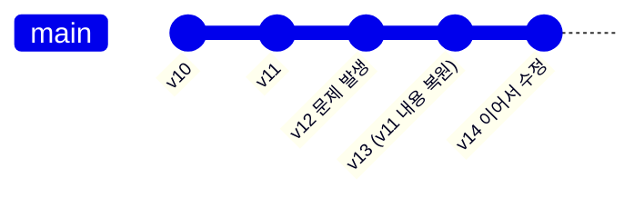
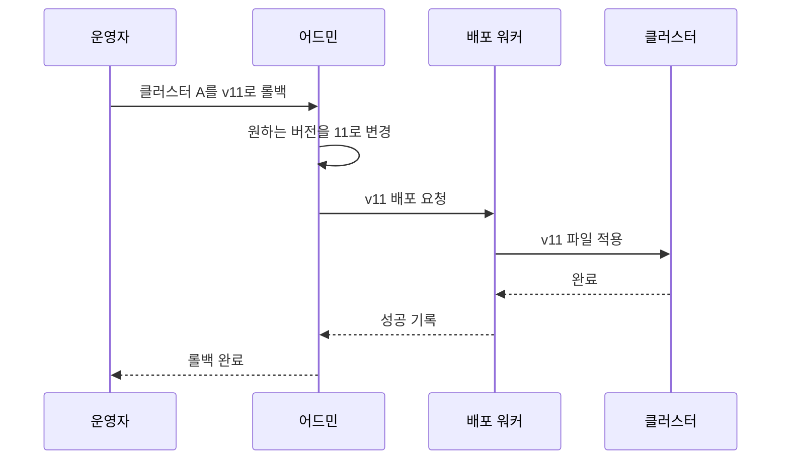
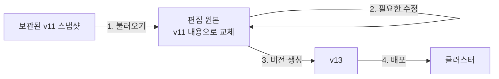
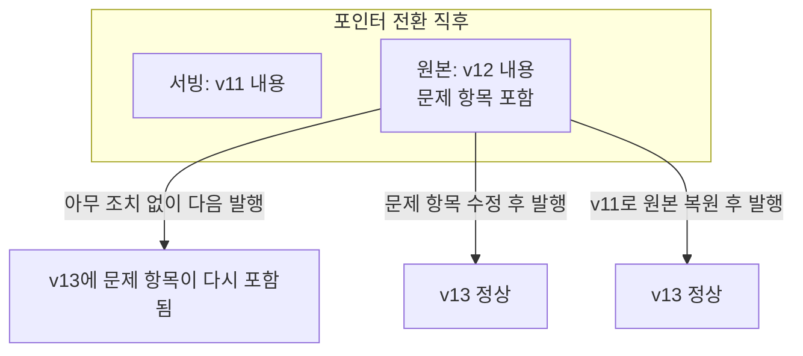

# 롤백과 롤포워드

문제가 생긴 배포를 되돌리는 방법은 "과거를 다시 가리키는 것"과 "과거 내용으로 새 버전을 만드는 것" 두 가지다. 둘은 속도와 이력의 모양이 다르고, 사전에서는 되돌릴 대상이 서빙 중인 파일과 편집 원본 두 곳이라는 점이 설계를 복잡하게 만든다.

## 두 가지 되돌리기

| 항목 | 롤백(Rollback) | 롤포워드(Roll-forward) |
|---|---|---|
| 동작 | 대상이 이전 버전을 다시 가리키게 함 | 이전 내용을 담은 새 버전을 만들어 배포 |
| 버전 번호 | 뒤로 감: 12 → 11 | 앞으로 감: 12 → 13 (내용은 11과 동일) |
| 속도 | 빠름. 이미 있는 것을 가리키기만 함 | 느림. 버전 생성 절차를 거침 |
| 이력 | "12를 썼다가 11로 돌아감"이 배포 이력에만 남음 | 버전 이력 자체에 되돌림이 한 줄로 남음 |
| 이어서 편집 | 원본은 12 상태 그대로 | 원본이 11 내용으로 돌아와 바로 이어서 편집 가능 |

Git의 두 명령이 같은 구분을 보여 준다. `reset`은 브랜치를 과거 커밋으로 옮기고, `revert`는 과거 변경을 취소하는 새 커밋을 쌓는다.

- 롤포워드에서 지켜지는 성질
  - 버전 번호가 항상 증가하므로 "가장 큰 번호가 최신"이라는 규칙이 깨지지 않음
  - 문제가 있었던 버전 12도 이력에 그대로 남아 나중에 원인을 분석할 수 있음

## 포인터 전환 롤백

가장 빠른 복구 수단이다. 클러스터가 사용하는 버전을 가리키는 값을 이전 버전으로 바꾸고, 해당 버전의 파일을 다시 적용한다.

- 전제 조건
  - 이전 버전의 파일이 수정되지 않은 채 보관되어 있어야 함
  - 보관 기간이 지나 삭제된 버전은 롤백 대상이 될 수 없음
- 배포와 같은 경로를 쓰는 이유
  - 롤백 전용 절차는 평소에 실행되지 않아 정작 필요할 때 동작하지 않을 위험이 큼
  - 버전 번호만 다른 일반 배포로 처리하면 매일 검증되는 경로를 그대로 사용하게 됨
- 완료의 정의
  - 파일이 바뀐 것만으로는 검색 결과가 돌아오지 않을 수 있음
  - 검색 시점에 읽는 사전은 분석기를 다시 불러오면 반영됨
  - 색인 시점에 쓰인 사전은 문서를 다시 색인해야 반영됨
  - 롤백 완료를 "파일 교체"로 볼지 "검색 결과 복구"로 볼지 미리 정해야 함

## 원본 복원과 롤포워드

서빙 중인 파일을 되돌리는 것과 별개로, 운영자가 편집하는 원본을 과거 내용으로 되돌려야 할 때가 있다. 과거 버전을 불러와 조금 고친 뒤 다시 내고 싶은 경우가 대표적이다.

- 절차의 요점
  - 불러오기는 원본의 현재 내용을 덮어쓰므로 진행 중인 편집이 있으면 경고 후 진행
  - 새 버전 번호는 불러온 버전과 무관하게 다음 번호를 부여
  - 새 버전의 메타데이터에 "버전 11에서 복원됨"을 기록해 계보를 남김
- 포인터 전환과의 조합
  - 장애 대응: 먼저 포인터 전환으로 서비스 복구
  - 사후 정리: 원본을 복원하고 수정한 뒤 정상 발행 절차로 새 버전 배포

## 서빙과 원본의 불일치

포인터 전환만 하고 원본을 그대로 두면 두 곳이 서로 다른 내용을 갖게 된다. 클러스터는 버전 11을 쓰고 있지만 편집 원본에는 문제를 일으킨 버전 12의 내용이 남아 있다.

- 불일치를 다루는 선택지
  - 수동 수정: 운영자가 원본에서 문제 항목을 직접 고침. 가장 단순하지만 잊기 쉬움
  - 원본 자동 복원: 롤백과 동시에 원본도 해당 버전으로 되돌림. 일관성은 높지만 그사이의 다른 편집이 함께 사라짐
  - 발행 차단: 롤백된 상태에서는 확인 절차를 거쳐야만 다음 발행이 가능하게 함
- 불일치를 드러내는 장치
  - 발행 전 변경 확인의 기준을 "직전에 만든 버전"이 아니라 "현재 서빙 중인 버전"으로 두면, 문제 항목이 변경 목록에 다시 나타나 운영자가 알아챌 수 있음
  - 화면에 "서빙 버전과 최신 버전이 다름"을 상시 표시

## 롤백 가능 범위

모든 과거로 돌아갈 수 있는 것은 아니며, 되돌릴 수 있는 한계를 정책으로 명시해 두어야 한다.

- 범위를 정하는 요소
  - 보관 정책: 보관 중인 버전까지만 롤백 가능
  - 형식 호환성: 사전 파일 형식이나 분석기 설정이 바뀌었다면 그 이전 버전은 현재 시스템에 올릴 수 없음
  - 연관 데이터: 사전과 함께 바뀐 다른 설정이 있다면 사전만 되돌려서는 과거 동작이 재현되지 않음
- 운영 수칙
  - 롤백 대상 목록에는 실제로 적용 가능한 버전만 표시
  - 현재 어느 클러스터에서든 사용 중인 버전은 보관 정책과 무관하게 삭제하지 않음
  - 정기적으로 롤백을 실제로 실행해 절차가 살아 있는지 확인

## 실패 유형별 대응

되돌리기의 수단은 문제가 어디서 생겼는지에 따라 달라진다.

| 증상 | 원인 위치 | 대응 |
|---|---|---|
| 배포 작업이 중간에 실패 | 배포 과정 | 같은 버전으로 재시도 |
| 일부 클러스터만 구버전으로 남음 | 배포 과정 | 원하는 버전과 적용된 버전을 비교해 해당 클러스터만 재배포 |
| 배포는 성공했으나 검색 품질이 나빠짐 | 사전 내용 | 포인터 전환 롤백 후 원본 수정 |
| 잘못된 일괄 편집이 원본에 들어감 (발행 전) | 편집 원본 | 보관된 버전으로 원본 복원 |
| 사전 파일이 분석기에 올라가지 않음 | 사전 형식 | 포인터 전환 롤백, 발행 전 검사 항목에 로딩 테스트 추가 |
