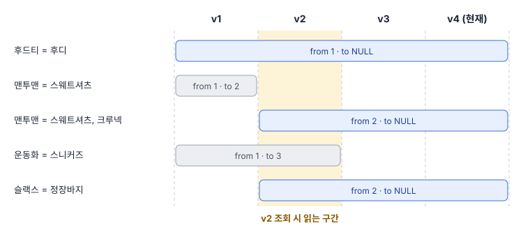
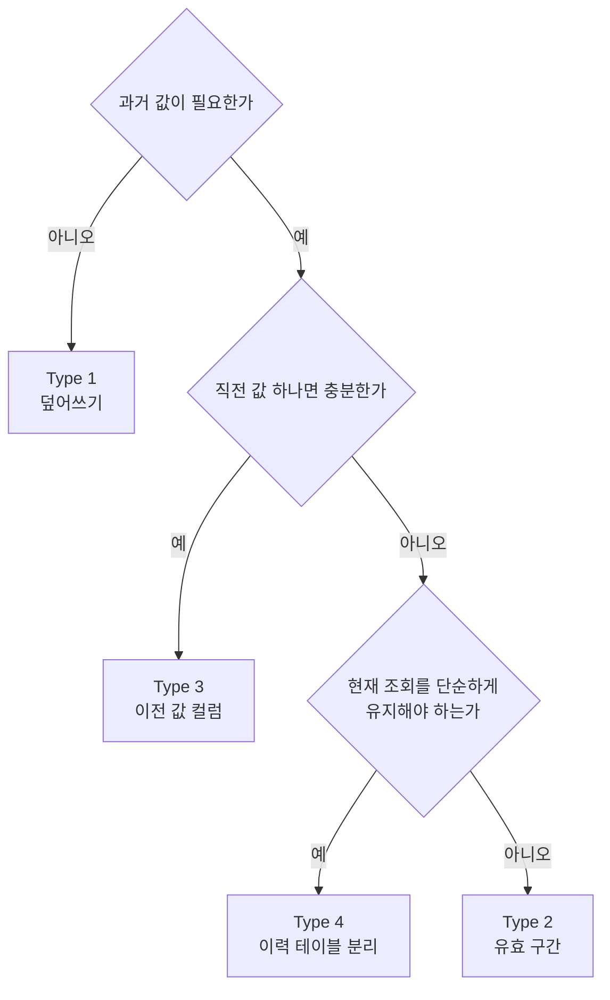

# SCD: 변경 이력을 행에 남기기

SCD(Slowly Changing Dimension, 천천히 변하는 차원)는 데이터 웨어하우스에서 온 용어로, 가끔씩 값이 바뀌는 데이터의 과거 값을 어떻게 다룰지를 유형 번호로 분류한 것이다. 사전의 한 행(표제어와 동의어)은 가끔 수정되고 과거 값을 다시 봐야 하므로 이 분류가 그대로 들어맞는다.

## 유형 한눈에 보기

유형 번호는 발전 단계가 아니라 서로 다른 선택지의 이름이다. 번호가 크다고 더 좋은 방식이 아니며, 남기려는 이력의 깊이에 맞춰 고른다.

| 유형 | 값이 바뀔 때 하는 일 | 남는 이력 | 사전 설계에서의 모습 |
|---|---|---|---|
| Type 0 | 바꾸지 않음 | 최초 값만 | 한 번 발행한 버전은 수정 불가로 두는 규칙 |
| Type 1 | 덮어씀 | 없음 | TRUNCATE 후 재적재, 같은 경로에 덮어쓰기 |
| Type 2 | 새 행을 추가하고 옛 행의 유효 구간을 닫음 | 모든 버전 | 유효 구간 컬럼 |
| Type 3 | 이전 값을 옆 컬럼으로 옮김 | 직전 값 하나 | before 컬럼 |
| Type 4 | 현재 테이블과 이력 테이블을 분리 | 모든 버전 | 라이브 테이블 + 히스토리 테이블 |
| Type 6 | Type 1, 2, 3을 함께 적용 | 모든 버전 + 현재 값 빠른 조회 | 유효 구간 행에 현재 값 컬럼을 추가 |

## Type 1: 덮어쓰기

가장 단순한 방식으로, 새 값이 옛 값을 지운다. 테이블 전체를 비우고 다시 채우는 전체 갱신(Full refresh, Truncate-and-load)도 결과적으로 같은 유형이다.

수정 전

| term | synonyms |
|---|---|
| 맨투맨 | 스웨트셔츠 |

수정 후

| term | synonyms |
|---|---|
| 맨투맨 | 스웨트셔츠, 크루넥 |

- 장점
  - 테이블 구조와 쿼리가 가장 단순함
  - 저장량이 현재 행 수로 고정됨
- 단점
  - 수정 전 값을 알 수 없어 변경 확인과 롤백이 불가능함
  - 잘못된 수정이 들어가도 언제 누가 바꿨는지 데이터만으로는 추적할 수 없음
- 적합한 경우
  - 오타 수정처럼 과거 값이 의미 없는 속성
  - 원본이 다른 곳에 있어 언제든 다시 만들 수 있는 파생 데이터

## Type 2: 유효 구간이 있는 새 행

값이 바뀌면 기존 행을 고치지 않고 새 행을 추가한다. 각 행은 자신이 유효한 구간을 `valid_from`, `valid_to` 두 컬럼으로 갖고, 지금도 유효한 행은 `valid_to`가 비어 있다.



같은 내용을 테이블로 보면 표제어 하나가 여러 행을 가질 수 있다.

| term | synonyms | valid_from | valid_to |
|---|---|---|---|
| 후드티 | 후디 | 1 | NULL |
| 맨투맨 | 스웨트셔츠 | 1 | 2 |
| 맨투맨 | 스웨트셔츠, 크루넥 | 2 | NULL |
| 운동화 | 스니커즈 | 1 | 3 |
| 슬랙스 | 정장바지 | 2 | NULL |

**읽기.** 특정 버전의 사전은 그 버전을 포함하는 구간의 행만 고르면 된다. 구간은 시작을 포함하고 끝을 포함하지 않는 것으로 정해 두면 경계에서 헷갈리지 않는다.

```sql
SELECT term, synonyms
FROM dictionary
WHERE valid_from <= 2
  AND (valid_to IS NULL OR valid_to > 2);
```

**쓰기.** 새 버전을 발행할 때는 사라지거나 바뀐 행의 구간을 닫고, 추가되거나 바뀐 행을 새로 여는 두 동작을 한 트랜잭션으로 묶는다. 버전 3에서 `운동화`를 지우고 `러닝화`를 추가하는 경우는 다음과 같다.

```sql
BEGIN;

UPDATE dictionary
SET valid_to = 3
WHERE term = '운동화' AND valid_to IS NULL;

INSERT INTO dictionary (term, synonyms, valid_from, valid_to)
VALUES ('러닝화', '조깅화', 3, NULL);

COMMIT;
```

**비교.** 어떤 버전에서 무엇이 바뀌었는지는 구간의 양 끝에 이미 적혀 있다. 별도 비교 연산 없이 조건 하나로 변경분이 나온다.

```sql
SELECT term, synonyms,
       CASE WHEN valid_from = 3 THEN '추가됨' ELSE '제거됨' END AS change
FROM dictionary
WHERE valid_from = 3 OR valid_to = 3;
```

- 장점
  - 바뀌지 않은 행은 복사하지 않아 저장량이 변경량에 비례함
  - 어느 버전이든 쿼리 한 번으로 재구성됨
  - 버전 간 변경분을 조건절만으로 구할 수 있음
- 단점
  - 모든 조회에 구간 조건이 붙어 쿼리 실수가 나기 쉬움
  - 표제어가 더 이상 유일하지 않아 유일성 제약을 따로 설계해야 함
  - 삭제를 행 제거가 아닌 구간 닫기로 표현해야 함
- 구현 시 주의점
  - 구간 기준: 날짜 대신 발행 버전 번호를 쓰면 발행 단위와 이력 단위가 일치함
  - 구간 겹침 방지: PostgreSQL에서는 `EXCLUDE USING gist (term WITH =, int4range(valid_from, valid_to) WITH &&)` 제약으로 강제 가능
  - 현재 행 조회 최적화: `valid_to IS NULL` 조건의 부분 인덱스 사용
  - 대리 키: 표제어 대신 일련번호를 기본 키로 두어 행 버전을 구분

## Type 3: 이전 값 컬럼

행은 그대로 두고 직전 값을 담는 컬럼을 하나 추가한다. 값이 바뀌면 현재 값을 이전 값 컬럼으로 옮긴 뒤 새 값을 쓴다.

| term | synonyms | synonyms_before |
|---|---|---|
| 맨투맨 | 스웨트셔츠, 크루넥 | 스웨트셔츠 |
| 슬랙스 | 정장바지 | NULL |

- 장점
  - 행 수가 늘지 않고 표제어 유일성이 유지됨
  - 바꾸기 전과 후를 한 행에서 바로 보여줄 수 있음
- 단점
  - 두 번 수정하면 첫 번째 값이 사라짐
  - 삭제된 행은 이전 값을 담을 자리가 없어 별도 삭제 표시가 필요함
  - 여러 버전 전으로 되돌리는 롤백을 지원할 수 없음
- 적합한 경우
  - 직전 발행 대비 변경분만 보여주면 충분하고 깊은 이력은 다른 저장소가 맡는 구조

## Type 0, 4, 6

나머지 유형은 단독으로 쓰이기보다 다른 유형을 보완하는 규칙이나 조합으로 등장한다.

- Type 0: 원본 유지
  - 한 번 기록한 값은 절대 바꾸지 않는 규칙
  - 발행된 버전의 내용을 수정 금지로 두는 정책이 이 유형에 해당함
- Type 4: 이력 테이블 분리
  - 현재 값은 원래 테이블에 덮어쓰고, 바뀌기 전 값은 별도 이력 테이블에 쌓는 방식으로 통용됨
  - 현재 조회는 Type 1처럼 단순하고 이력은 Type 2처럼 남는 절충안
  - 원래 정의는 자주 바뀌는 속성을 별도 작은 차원 테이블로 떼어내는 기법이며, 실무에서는 이력 테이블 분리의 뜻으로 더 자주 쓰임
- Type 6: 혼합
  - 유효 구간 행(Type 2)에 현재 값 컬럼(Type 3)을 추가하고, 그 컬럼은 모든 행에서 덮어씀(Type 1)
  - 과거 행을 읽으면서도 현재 값을 조인 없이 함께 볼 수 있음
  - 번호는 1 + 2 + 3 = 6에서 유래함

## 시스템 버전 테이블

Type 2를 애플리케이션이 직접 구현하는 대신 데이터베이스가 대신해 주는 기능이 있다. SQL:2011 표준의 시스템 버전 테이블(system-versioned table, temporal table)로, 행을 수정하거나 삭제하면 DB가 옛 행을 자동으로 보관하고 `FOR SYSTEM_TIME AS OF` 구문으로 과거 시점을 조회하게 해 준다.

- 지원 현황
  - MariaDB, SQL Server, Db2, Oracle(Flashback 기반)에서 기본 제공
  - PostgreSQL은 기본 제공하지 않아 트리거나 확장으로 구현해야 함
- 사전 버전 관리에 그대로 쓰기 어려운 이유
  - 기준이 시각이라 "발행 버전"이라는 업무 단위와 일치하지 않음
  - 편집 중의 모든 중간 저장까지 이력으로 남아 발행 단위 비교가 번거로움
- 쓰임새
  - 누가 언제 무엇을 바꿨는지 추적하는 감사 용도에는 가장 적은 노력으로 맞음

## 선택 기준

유형을 고를 때는 요구사항을 이력의 깊이로 바꿔 읽으면 된다.



- 롤백과 임의 버전 비교가 요구사항이면 Type 2 또는 Type 4
- 배포 전 변경 확인만 필요하면 Type 3으로도 충족 가능
- 운영 화면의 조회 쿼리를 건드리고 싶지 않으면 Type 4
