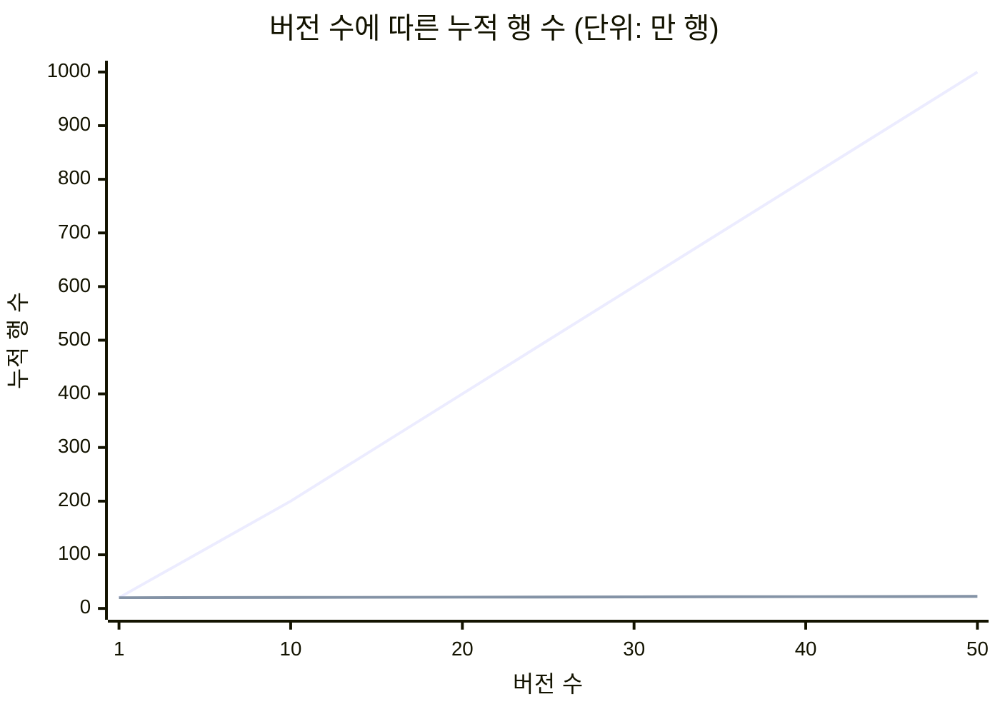
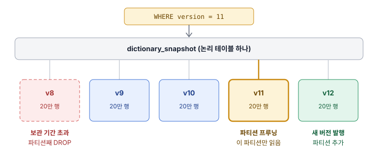

# 스냅샷 테이블과 파티셔닝

버전을 발행할 때마다 사전 전체를 통째로 복사해 두는 방식이다. 이해하기 가장 쉽고 조회도 단순하지만 저장량이 빠르게 늘기 때문에, 보통 파티셔닝과 보관 기간 정책을 함께 설계한다.

## 전체 스냅샷 테이블

스냅샷(Snapshot)은 어느 한 시점의 상태 전체를 그대로 찍어 둔 사본이다. 테이블에 `version` 컬럼을 두고, 발행할 때마다 그 시점의 모든 행을 새 버전 번호로 복사해 넣는다.

| version | term | synonyms |
|---|---|---|
| 1 | 후드티 | 후디 |
| 1 | 맨투맨 | 스웨트셔츠 |
| 1 | 운동화 | 스니커즈 |
| 2 | 후드티 | 후디 |
| 2 | 맨투맨 | 스웨트셔츠, 크루넥 |
| 2 | 운동화 | 스니커즈 |
| 2 | 슬랙스 | 정장바지 |

바뀐 행은 `맨투맨`과 `슬랙스` 둘뿐이지만 버전 2에는 네 행이 모두 다시 저장된다. 그 대가로 특정 버전의 조회가 조건 하나로 끝난다.

```sql
SELECT term, synonyms
FROM dictionary_snapshot
WHERE version = 2;
```

- 장점
  - 버전 조회와 버전 간 비교가 평범한 SQL로 해결됨
  - 각 버전이 독립적이라 한 버전을 지워도 다른 버전에 영향이 없음
  - 롤백 대상의 내용을 운영 화면에서 바로 보여줄 수 있음
- 단점
  - 바뀌지 않은 행까지 복사해 저장량이 행 수 × 버전 수로 증가함
  - 발행할 때마다 전체 행을 쓰는 비용이 발생함

## 저장량이 늘어나는 모양

스냅샷과 반대되는 개념은 델타(Delta), 즉 바뀐 부분만 저장하는 방식이다. 사전이 20만 행이고 버전마다 500행이 바뀐다고 가정하면 두 방식의 차이는 버전이 쌓일수록 벌어진다.



가파르게 올라가는 파란 선이 전체 스냅샷, 바닥에 붙어 있는 주황 선이 변경분만 저장하는 방식이다.

- 전체 스냅샷: 50개 버전에서 1,000만 행
- 변경분만 저장: 50개 버전에서 약 22만 5천 행
- 판단 기준: 1,000만 행은 관계형 DB가 충분히 감당하는 크기이며, 문제는 크기 자체보다 무한히 늘어나는 것을 막을 장치의 유무임

## 파티셔닝

파티셔닝(Partitioning)은 논리적으로는 하나인 테이블을 특정 컬럼 값에 따라 물리적으로 여러 조각에 나눠 저장하는 기능이다. 쿼리는 테이블 하나를 대상으로 쓰지만, DB는 조건에 맞는 조각만 읽는다.



- 파티션 프루닝(Partition pruning)
  - 조건절을 보고 읽을 필요가 없는 파티션을 실행 계획에서 제외하는 동작
  - 버전이 100개여도 `WHERE version = 11` 조회는 파티션 하나의 크기만큼만 비용이 듦
- 파티션을 나누는 기준
  - 범위(Range): 날짜나 번호 구간으로 나눔
  - 목록(List): 값 하나하나에 파티션을 지정함. 버전 번호처럼 값이 명확할 때 적합
  - 해시(Hash): 값의 해시로 균등하게 나눔. 특정 조각을 골라 지울 수 없어 버전 관리에는 부적합

PostgreSQL에서는 부모 테이블을 선언하고 버전마다 파티션을 붙인다.

```sql
CREATE TABLE dictionary_snapshot (
    version   int  NOT NULL,
    term      text NOT NULL,
    synonyms  text NOT NULL,
    PRIMARY KEY (version, term)
) PARTITION BY LIST (version);

CREATE TABLE dictionary_snapshot_v12
    PARTITION OF dictionary_snapshot
    FOR VALUES IN (12);
```

- 설계 시 주의점
  - 기본 키와 유일 인덱스에는 파티션 키가 반드시 포함되어야 함
  - 발행 절차에 파티션 생성 단계가 들어가야 함
  - 플랫폼이나 언어처럼 구분 축이 더 있으면 하위 파티션보다 일반 컬럼 + 인덱스로 두는 편이 관리가 쉬움

## 파티션 리텐션

리텐션(Retention)은 데이터를 얼마 동안 보관할지 정한 규칙이다. 최근 N개 버전만 남기는 식으로 창을 밀어 가며 유지하는 것을 롤링 윈도우(Rolling window)라고 부른다.

오래된 버전을 지우는 방법에 따라 비용 차이가 크다.

| 방법 | 동작 | 비용 |
|---|---|---|
| `DELETE WHERE version = 8` | 행을 하나씩 삭제 표시 | 느리고, 죽은 행을 청소하는 작업이 뒤따름 |
| 파티션 `DROP` | 조각 파일을 통째로 제거 | 행 수와 무관하게 즉시 끝남 |

```sql
ALTER TABLE dictionary_snapshot DETACH PARTITION dictionary_snapshot_v8;
DROP TABLE dictionary_snapshot_v8;
```

- 리텐션 정책에 담을 내용
  - 보관 개수 또는 기간: 롤백을 허용할 범위와 동일하게 맞춤
  - 예외: 현재 어느 클러스터든 사용 중인 버전은 삭제 대상에서 제외
  - 보관 기간이 지난 버전의 처리: 완전 삭제 또는 저렴한 저장소로 내보낸 뒤 삭제

## 버전마다 테이블

파티셔닝 기능을 쓰지 않고 `dictionary_v11`, `dictionary_v12`처럼 버전마다 테이블을 직접 만드는 방식도 있다. 분석 도구에서 `events_20240101`처럼 날짜별 테이블을 만들던 관행에서 온 것으로, 샤딩 테이블(Sharded table)이라고 부른다.

| 항목 | 버전마다 테이블 | 파티션 테이블 |
|---|---|---|
| 쿼리 대상 | 버전마다 테이블 이름이 달라 동적 SQL 필요 | 항상 같은 테이블 이름 |
| 여러 버전 비교 | 테이블끼리 직접 조인 | 같은 테이블을 버전 조건으로 두 번 읽음 |
| 스키마 변경 | 테이블마다 따로 적용, 버전 간 불일치 위험 | 부모 테이블에 한 번 적용 |
| 삭제 | `DROP TABLE` | 파티션 `DROP` |
| ORM 호환 | 테이블 이름이 고정이 아니라 다루기 불편 | 일반 테이블과 동일 |

두 방식의 물리적 모습은 거의 같다. 파티션 테이블은 버전별 테이블 묶음 위에 "하나의 이름"을 얹어 준 것이므로, 파티셔닝을 지원하는 DB라면 직접 테이블을 나눌 이유가 거의 없다.
