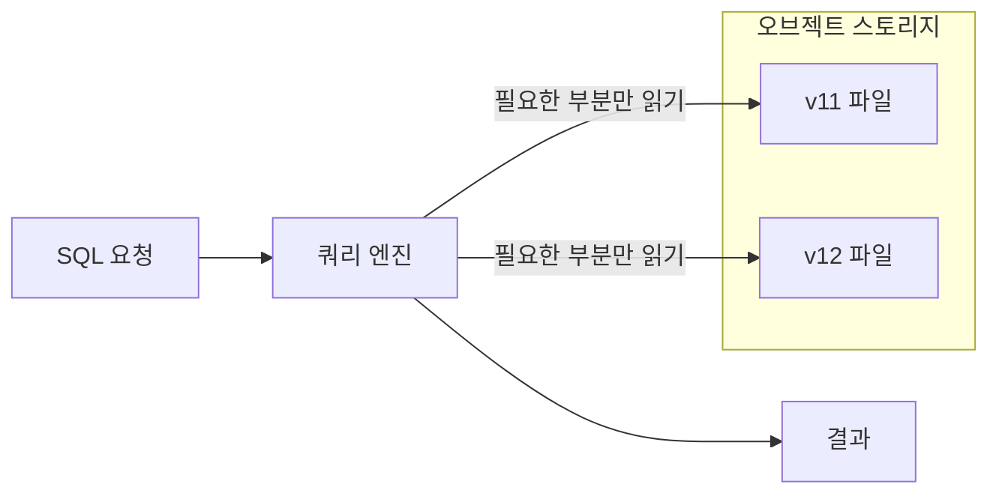
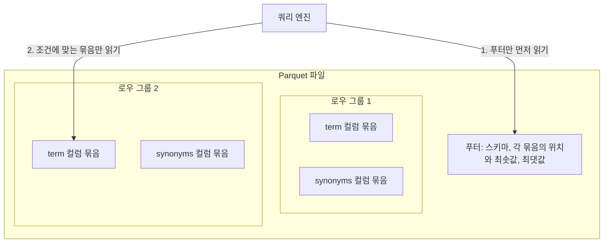
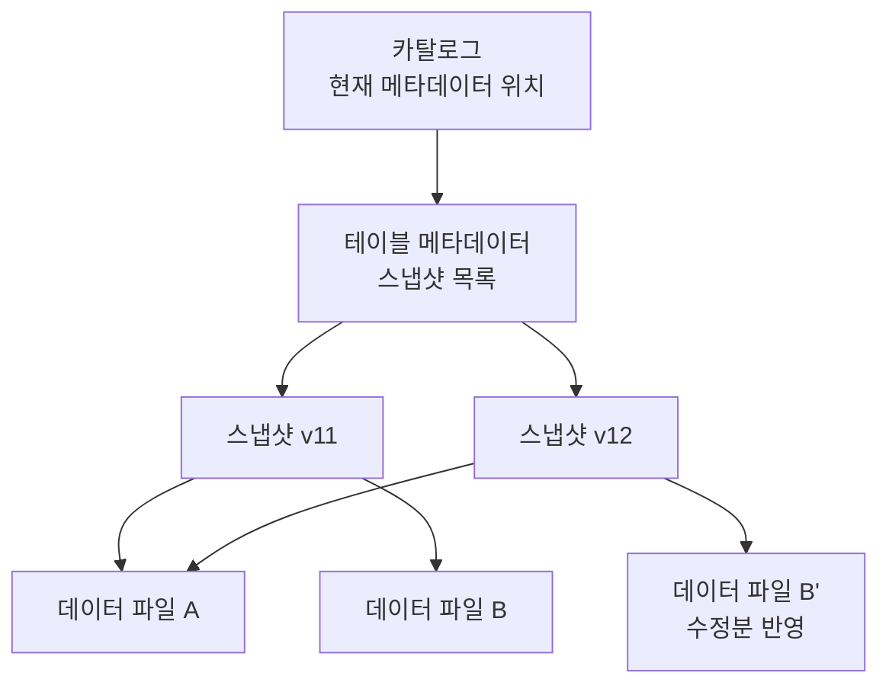

# 오픈 테이블 포맷과 타임 트래블

오브젝트 스토리지의 파일을 내려받지 않고 그 자리에서 SQL로 조회하고, 나아가 파일 묶음을 버전이 있는 테이블처럼 다루는 기술이다. "과거 버전을 조회한다"는 요구를 저장 계층이 기본 기능으로 제공한다는 점에서 개념적으로 가장 정확히 들어맞는다.

## 쿼리 인 플레이스

쿼리 인 플레이스(Query-in-place)는 데이터를 DB로 옮겨 싣지 않고 저장된 위치에 둔 채로 쿼리하는 방식이다. 쿼리 엔진이 필요한 파일의 필요한 부분만 네트워크로 읽어 와서 계산한다.



- 대표적인 엔진
  - Amazon Athena: 서버 없이 쿼리당 과금되는 관리형 서비스
  - Trino, Spark: 직접 운영하는 분산 쿼리 엔진
  - DuckDB: 애플리케이션 프로세스 안에 내장되는 분석용 엔진으로, 원격 파일을 직접 읽을 수 있음
- 장점
  - 파일을 받아 임시로 저장하고 지우는 코드가 사라짐
  - 저장소와 계산이 분리되어 조회가 없을 때는 계산 비용이 들지 않음
- 단점
  - 쿼리마다 초 단위 지연이 있어 화면의 즉각적인 조회에는 부적합
  - 엔진이라는 운영 요소가 하나 추가됨

## Parquet

쿼리 인 플레이스가 실용적이려면 파일의 일부만 읽을 수 있어야 한다. CSV는 원하는 행이 어디 있는지 알 수 없어 처음부터 끝까지 읽어야 하지만, Parquet은 파일 안에 목차를 갖고 있다.



- 컬럼 지향 저장(Columnar)
  - 행 단위가 아니라 컬럼 단위로 값을 모아 저장
  - 같은 종류의 값이 붙어 있어 압축률이 높고 필요한 컬럼만 읽을 수 있음
- 로우 그룹(Row group)
  - 행을 일정 개수씩 묶은 단위
  - 묶음마다 컬럼별 최솟값과 최댓값이 기록됨
- 건너뛰기
  - 엔진이 푸터의 통계를 보고 조건에 맞지 않는 로우 그룹을 읽지 않음
  - 표제어로 정렬해 저장하면 특정 표제어 조회가 로우 그룹 하나로 좁혀짐

## 오픈 테이블 포맷

Parquet 파일을 여러 개 쌓아 두는 것만으로는 테이블이 되지 않는다. 어떤 파일들이 지금 유효한지, 쓰는 도중에 읽으면 어떻게 되는지를 정해 주는 층이 없기 때문이다. 오픈 테이블 포맷(Open table format)은 데이터 파일 위에 메타데이터 층을 얹어 이 문제를 푼다.

- 대표 포맷: Apache Iceberg, Delta Lake, Apache Hudi
- 메타데이터 층이 제공하는 것
  - 원자적 커밋: 여러 파일의 추가와 제거가 한 번에 반영되거나 전혀 반영되지 않음
  - 스냅샷: 커밋마다 "이 시점의 테이블을 구성하는 파일 목록"이 남음
  - 스키마 변경: 컬럼 추가와 이름 변경을 과거 파일을 다시 쓰지 않고 처리

Iceberg의 구조를 보면 스냅샷이 파일을 복사하지 않고 목록만 새로 만든다는 점이 드러난다.



- 스냅샷 v11과 v12는 바뀌지 않은 데이터 파일 A를 함께 가리킴
- 수정이 있었던 파일만 새로 쓰이고 나머지는 재사용됨
- 카탈로그가 가리키는 위치를 바꾸는 한 번의 연산이 커밋이 됨

## 타임 트래블

타임 트래블(Time travel)은 과거 스냅샷을 지정해 그 시점의 테이블을 조회하는 기능이다. 스냅샷마다 파일 목록이 남아 있으므로 과거 조회는 "예전 목록으로 읽기"일 뿐이고 별도의 복원 작업이 필요 없다.

```sql
-- 특정 버전의 사전 조회 (Delta Lake)
SELECT * FROM dictionary VERSION AS OF 11;

-- 특정 시각의 사전 조회 (Iceberg, Spark SQL)
SELECT * FROM dictionary TIMESTAMP AS OF '2025-03-01 00:00:00';

-- 과거 버전으로 테이블 되돌리기 (Delta Lake)
RESTORE TABLE dictionary TO VERSION AS OF 11;
```

- 함께 제공되는 기능
  - 태그: 스냅샷에 `release-12` 같은 이름을 붙여 삭제되지 않게 고정
  - 브랜치: 운영 테이블과 분리된 줄기에 쓰고 검증한 뒤 합치는 흐름 지원
  - 변경분 조회: 두 스냅샷 사이에 추가되고 삭제된 행을 읽는 기능
- 관리해야 할 것
  - 스냅샷 만료: 오래된 스냅샷을 정리하지 않으면 메타데이터와 파일이 계속 쌓임
  - 만료된 스냅샷은 타임 트래블 대상에서 사라지므로 보관 기간이 곧 롤백 가능 범위가 됨

## 사전 규모에서의 판단

이 기술들은 수억 행, 수백 기가바이트 단위의 분석 테이블을 위해 만들어졌다. 수십만 행 규모의 사전에는 기능은 정확히 맞지만 운영 부담이 이득보다 클 수 있다.

- 도입이 과한 신호
  - 데이터가 관계형 DB 한 대에 여유 있게 들어감
  - 조직에 카탈로그와 쿼리 엔진을 운영하는 팀이 없음
  - 화면에서 즉각적인 응답이 필요함
- 도입을 고려할 신호
  - 이미 데이터 플랫폼에 Iceberg나 Delta Lake가 운영되고 있음
  - 사전 외에도 버전 관리가 필요한 대형 데이터가 함께 있음
  - 비교와 조회가 배치성이라 초 단위 지연이 문제 되지 않음
- 개념만 빌려 쓰는 방법
  - 스냅샷 = 파일 목록이라는 발상을 매니페스트 파일로 직접 구현
  - 바뀌지 않은 파일은 다시 올리지 않고 이전 버전의 파일을 그대로 참조
